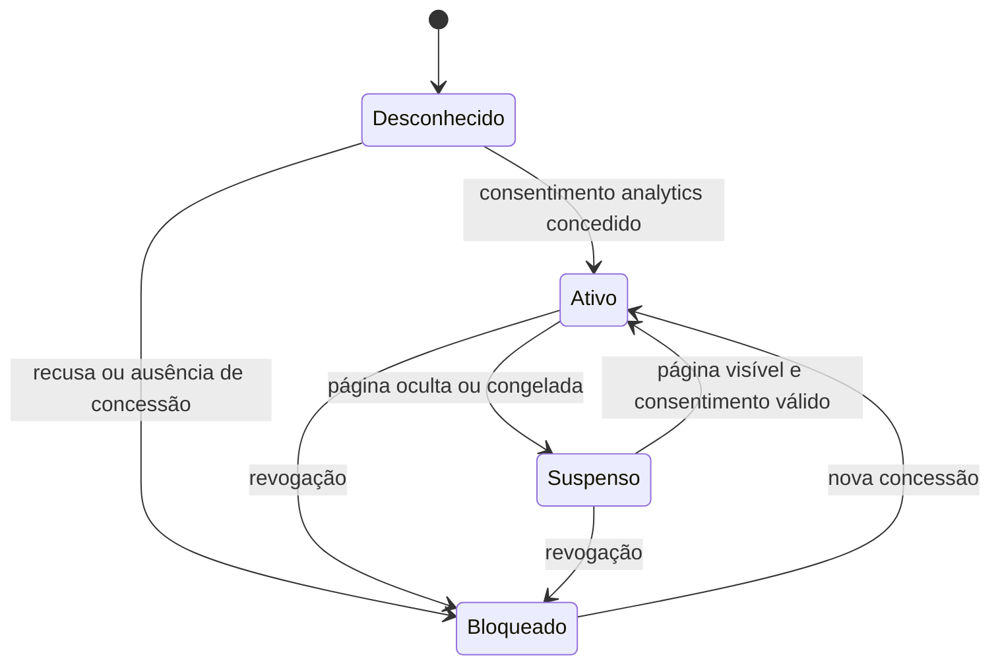

# Coleta própria: contrato de eventos, sessões, atribuição e métricas

**Estado:** especificação de planejamento. Nenhum coletor, endpoint, migração, configuração de consentimento ou teste de aplicação é implementado por este arquivo. Data de referência: **12/10/2026, America/Sao_Paulo**.

Projeto: [Zoriek1/LandingPage](https://github.com/Zoriek1/LandingPage). Base de código inspecionada: [`2b2a937846e09e6603733fe7b725882503685d58`](https://github.com/Zoriek1/LandingPage/tree/2b2a937846e09e6603733fe7b725882503685d58). As regras abaixo descrevem o sistema **a construir**; a seção 2 diferencia o que já existe. O código desse commit prevalece sobre documentação antiga divergente.

Este documento especifica a coleta que alimentará o painel. A arquitetura de servidor e operação consta em [02-api-banco-seguranca-e-deploy.md](02-api-banco-seguranca-e-deploy.md); a experiência do painel e sua interpretação constam em [03-dashboard-produto-e-decisoes.md](03-dashboard-produto-e-decisoes.md) e seguem as mesmas definições deste contrato. O plano geral será o índice desta pasta.

## 1. Objetivo e limites de escopo

A prioridade é observar **uso, engajamento e escolhas nas páginas** para orientar testes de marketing. Ações de contato são o objetivo secundário. O dashboard terá métricas próprias, sessões próprias, armazenamento próprio e atribuição por UTM; não precisará do GA4 para calcular ou exibir dados.

O navegador mede interações que não geram requisições ao servidor, como scroll, abertura de FAQ e mudança de filtro. A API recebe eventos explícitos e saneados. Um middleware no servidor, sozinho, não vê essas ações. O painel mostrará o que foi observado e persistido, com atraso e cobertura indicados; não prometerá captura integral de toda ação ou identificação de todas as pessoas.

| Fase | Coleta e análise entregues | Estimativa acumulada condicionada |
| --- | --- | --- |
| A — V1 operacional | Visitas em todas as entradas, sessão/presença, tempo ativo estimado, scroll, CTAs principais, variante aplicada e UTM | 2–3 dias úteis para o conjunto API + painel + deploy, com infraestrutura/acessos prontos |
| B — comportamento | Exposição de seções/produtos/CTAs, filtros, expansão, FAQ, seletor, carrossel manual e jornadas detalhadas | 5–7 dias úteis para o sistema acumulado |
| C — operação ampliada | Diagnóstico, capacidade, exportação autorizada e revisão de retenção/recuperação | 7–12 dias úteis para o sistema acumulado |
| D — opcionais | Conversa e venda comprovadas pelo Gestor; custos de mídia; replay/heatmap com avaliação própria | Estimativa separada |

A fase A começa com o fluxo completo e poucos tipos de evento. A fase B amplia a cobertura por componente. Captura de conteúdo de formulário, texto livre, DOM completo, coordenadas, movimento contínuo do mouse, teclas digitadas e gravação de sessões não fazem parte das fases A–C.

## 2. Inventário verificado e diferenças a preservar

No código auditado:

- [`src/lib/tracking.ts`](https://github.com/Zoriek1/LandingPage/blob/2b2a937846e09e6603733fe7b725882503685d58/src/lib/tracking.ts) envia eventos existentes para destinos distintos: `dataLayer`, Meta e API externa de leads. `trackWhatsAppClick()` registra todo clique no `dataLayer`, mas suprime Contact/API de leads por quatro horas na mesma campanha quando houve confirmação HTTP.
- [`src/lib/whatsappModal.ts`](https://github.com/Zoriek1/LandingPage/blob/2b2a937846e09e6603733fe7b725882503685d58/src/lib/whatsappModal.ts) tem nome histórico de modal, mas seu helper abre o WhatsApp após tentar o tracking. Não há modal atual de captura de telefone do visitante nem evento atual de formulário de lead. Não criar métricas a partir do fluxo descrito em documentação antiga.
- [`src/lib/attribution.ts`](https://github.com/Zoriek1/LandingPage/blob/2b2a937846e09e6603733fe7b725882503685d58/src/lib/attribution.ts) já centraliza UTMs e click IDs. Quando chegam novas UTMs, limpa o conjunto anterior antes de salvar; a URL atual vence. Seu uso de armazenamento não representa, por si só, consentimento comprovado para o novo coletor.
- Home, LPs hidratadas e entradas sazonais têm `trackPageView()` inicial para a API de leads. A [`entrada da loja física`](https://github.com/Zoriek1/LandingPage/blob/2b2a937846e09e6603733fe7b725882503685d58/src/loja-fisica/main.ts) é TypeScript sem React e não chama esse PageView. Apenas adicionar o coletor em `src/main.tsx` deixaria rotas sem cobertura.
- `offer_variant_seen` hoje vai apenas ao `dataLayer` e é disparado quando uma variante válida modifica a configuração. O novo evento será persistido pela coleta própria com sua regra explícita de exposição.
- Os eventos de telefone e rota da loja física são cliques. Não comprovam ligação atendida, visita presencial ou compra.
- O prerender roda em Node. Importar coleta ou tracking não pode acessar `window`, cookies ou armazenamento no build; efeitos de coleta só começam no cliente elegível.

**Regra de integração:** adicionar uma emissão própria, independente da deduplicação comercial de quatro horas. Dois cliques reais podem produzir dois eventos de comportamento, mesmo quando apenas um Contact/lead externo foi enviado. Reenvios da **mesma interação** reutilizam o mesmo `event_id` e contam uma vez.

O dashboard não lerá dados do `dataLayer` como fonte canônica: depender de um contêiner externo ou de suas transformações recriaria dependências que o coletor próprio pretende eliminar. Os pontos existentes serão reutilizados como locais de integração, com schemas próprios e sem encaminhar integralmente os payloads antigos.

## 3. Identificadores e unidades de contagem

| Campo/conceito | Definição planejada | Limite de interpretação |
| --- | --- | --- |
| `project_id` | Identificador público estável do projeto, por exemplo `plante-uma-flor-lp`; validado pelo servidor | Não é segredo nem prova de origem legítima |
| `event_id` | Identificador da interação, criado uma vez; UUID criptográfico para eventos novos | Não gerar novo ID no retry |
| `batch_id` | UUID do lote transmitido, útil para diagnóstico | Deduplicação definitiva ocorre por `project_id` + `event_id` |
| `tab_id` | UUID do contexto de aba observado, mantido em `sessionStorage` após consentimento | Uma pessoa pode ter várias abas e sessões |
| `session_id` | UUID da sessão própria naquela aba; renovado após 30 minutos sem atividade elegível | Não é o `ga_session_id` nem identifica uma pessoa |
| `pageview_id` | UUID de uma apresentação elegível da página; novo por navegação, reload e restauração conforme seção 5 | Um page view pode ter vários eventos |
| `client_seq` | Inteiro crescente no documento cliente, utilizado para desempatar a ordem de eventos próximos | Não comprova entrega nem substitui timestamp/ID |
| `consent.scope_id` | UUID criado ao iniciar uma concessão de analytics; associa fila e eventos ao consentimento vigente | Revogação invalida o escopo local e impede reaproveitar sua fila |
| `release_sha` | SHA do código do coletor que emitiu o evento | Permite separar mudanças de instrumentação e conteúdo |

Para novas emissões, usar `crypto.randomUUID()` em contexto HTTPS, com alternativa criptográfica baseada em `crypto.getRandomValues()` se necessária. A API poderá aceitar IDs legados com 8–128 caracteres ASCII do conjunto `[A-Za-z0-9_-]`, porque o tracking atual não usa UUID. Isso facilita correlação futura de uma interação, mas não autoriza ingerir todos os payloads legados.

**Não haverá `visitor_id` persistente entre sessões na V1.** Os rótulos do painel serão “sessões observadas”, “abas com presença” e “visitas”. A quantidade de pessoas únicas não pode ser obtida com esse contrato. Nova identidade persistente exigirá objetivo, política de consentimento e definição próprios.

### 3.1. Sessão por aba e cópia de `sessionStorage`

`sessionStorage` separa contextos por origem/aba, sobrevive a reload e pode ser copiado inicialmente quando uma janela tem `opener`. Algumas ações de duplicar aba também precisam ser testadas em navegadores reais. Por isso, não basta salvar um UUID e presumir que nunca será compartilhado.

Proposta de implementação:

1. Guardar identidade/sessão no namespace exclusivo do coletor após concessão, sem ler IDs antigos como identidade própria.
2. Usar links/aberturas controlados com `noopener` onde já adequado à navegação do produto.
3. Fazer uma verificação curta de conflito entre instâncias da mesma origem usando `BroadcastChannel`, depois do consentimento. Uma instância nova que encontre outra aba viva com o mesmo `tab_id` cria novos `tab_id`/`session_id` e não envia a fila copiada.
4. A comunicação entre abas serve para evitar colisão e propagar revogação, não para reunir seus eventos numa pessoa.
5. Na indisponibilidade da verificação ou na identidade ambígua, preferir uma identidade em memória por documento à fusão silenciosa de duas jornadas. Isso pode fragmentar sessões em reloads; registrar `storage_mode`/qualidade e documentar a limitação.

O comportamento exato de duplicação, aba suspensa e restauração será critério de aceite. Esse mecanismo reduz colisões; não transforma o contador em pessoas únicas e não promete detectar todos os modos de restauração de cada navegador.

## 4. Contrato de ingestão versão 1

Endpoint público planejado: **`POST /collect`**. `schema_version` versiona o contrato do corpo. Todos os exemplos deste documento são sintéticos; não contêm credenciais e não configuram nenhum serviço.

### 4.1. Envelope do lote

```json
{
  "schema_version": 1,
  "project_id": "plante-uma-flor-lp",
  "batch_id": "e65845b0-807d-44c6-a457-4e7751bb4e5a",
  "events": [
    {
      "schema_version": 1,
      "event_id": "8f18f280-d013-4214-94fd-1a5fb1b290e1",
      "event_type": "page_view",
      "occurred_at": "2026-10-12T22:00:00.000Z",
      "session_id": "b11d612c-ae2e-42d3-ac39-08f53adf7e69",
      "tab_id": "4d2fabdc-0a41-4b7f-8adc-f045d55b6234",
      "pageview_id": "2b4bc294-9e27-43f5-8ab6-bf6a975ba596",
      "client_seq": 1,
      "release_sha": "2b2a937846e09e6603733fe7b725882503685d58",
      "path": "/lirios-apt",
      "lp_slug": "lirios-apt",
      "entry_type": "ad_lp",
      "device_class": "mobile",
      "attribution": {
        "session_entry": {
          "utm_source": "instagram",
          "utm_medium": "paid_social",
          "utm_campaign": "lirios-outubro"
        },
        "current": {
          "utm_source": "instagram",
          "utm_medium": "paid_social",
          "utm_campaign": "lirios-outubro"
        },
        "referrer_host": "instagram.com"
      },
      "consent": {
        "analytics": "granted",
        "policy_version": "analytics-v1",
        "scope_id": "12440710-801c-4fb3-a5b2-b2bd5f9e5362",
        "collected_at": "2026-10-12T22:00:00.000Z"
      },
      "props": {
        "navigation_reason": "initial",
        "storage_mode": "session",
        "scrollable": true
      }
    }
  ]
}
```

`release_sha` acima identifica a base auditada apenas para exemplificar o formato. Na aplicação futura deverá ser o SHA da release efetivamente publicada, gerado no build.

| Campo | Obrigatório | Validação/semântica |
| --- | --- | --- |
| Envelope `schema_version` | Sim | Inteiro suportado; iniciar com `1` |
| `project_id`, `batch_id`, `events` | Sim | Projeto conhecido, ID válido e array não vazio, respeitando limites |
| Evento `schema_version` | Sim | Compatível com o lote e schema conhecido |
| `event_id`, `event_type` | Sim | ID válido e tipo no catálogo publicado |
| `occurred_at` | Sim | ISO 8601 UTC; servidor adiciona `received_at`/`committed_at` próprios e avalia a qualidade do relógio |
| `session_id`, `tab_id`, `pageview_id` | Sim | UUIDs novos; IDs relacionais pseudônimos, nunca GA IDs |
| `release_sha`, `path` | Sim | SHA/versão conhecida e caminho canônico autorizado |
| `props` | Sim | Objeto específico do evento; sem propriedades arbitrárias ou nesting ilimitado |
| `consent` | Sim | Objeto estruturado de concessão, política/escopo e horário conhecido da autorização vigente |
| `client_seq` | Opcional, recomendado | Inteiro não negativo; reinicia por documento |
| `lp_slug`, `entry_type`, `device_class` | Opcionais no transporte, recomendados no coletor | Valores de enum/registro; quando ausentes, painel mostra “desconhecido” |
| `attribution` | Opcional | Somente campos autorizados e saneados; ausência não vira campanha inventada |

O servidor validará campos externos e internos, tamanho e combinações permitidas. Propriedades desconhecidas serão rejeitadas ou removidas por uma política publicada no schema; nunca persistidas sem análise. Para a V1, preferir rejeição por propriedade desconhecida para detectar erros de instrumentação cedo; saneamento de URL/UTM deve ocorrer antes, no cliente e novamente no servidor.

### 4.2. Limites iniciais propostos

| Item | Valor inicial | Motivo |
| --- | --- | --- |
| Eventos por lote | Até 50 | Limitar validação e resposta sem uma chamada por ação |
| Corpo JSON do lote | Até 32 KiB, medidos em bytes UTF-8 | Orçamento pequeno para envio no encerramento e abuso |
| Evento completo | Até 4 KiB | Impedir expansão de propriedades e captura indevida |
| Flush normal | A cada 2 s quando há fila | Buscar atualização em segundos sem excessiva quantidade de POSTs |
| Fila local | Até 100 eventos e 128 KiB, valendo o primeiro limite | Limitar memória/storage de falhas de rede |
| Vida máxima de evento não confirmado | 10 minutos | Não criar backlog duradouro ou reproduzir sessões antigas no feed |
| Tentativas normais | Até 5 tentativas totais: a primeira + até 4 reenvios, respeitando TTL | Limitar pressão sobre serviço indisponível |
| Heartbeat | 15 s em página visível | Presença e fatias de tempo estimado |
| Expiração de presença | 60 s sem sinal recente elegível | Tolerar pequenas interrupções sem manter sessões eternamente online |

32 KiB do lote pode ser atingido antes dos 50 eventos. O coletor divide a fila preservando o limite em bytes; não trunca JSON. O limite de 4 KiB inclui atributos comuns. Valores são recomendações a medir no primeiro ambiente; qualquer mudança deve atualizar o contrato e o plano de capacidade.

### 4.3. Confirmação, rejeição e duplicação

ACK planejado após transação persistida:

```json
{
  "schema_version": 1,
  "batch_id": "e65845b0-807d-44c6-a457-4e7751bb4e5a",
  "committed_at": "2026-10-12T22:00:01.400Z",
  "results": [
    {
      "index": 0,
      "event_id": "8f18f280-d013-4214-94fd-1a5fb1b290e1",
      "status": "accepted"
    }
  ],
  "counts": {
    "accepted": 1,
    "duplicate": 0,
    "rejected": 0
  }
}
```

- `accepted`: gravado uma vez e elegível para processamento conforme as regras de qualidade.
- `duplicate`: mesmo ID já gravado com conteúdo semântico equivalente; não recontar, não renovar presença pelo replay e não somar tempo ativo outra vez.
- `rejected`: evento não gravado; `code` enumerado explica o motivo sem ecoar dados potencialmente indevidos. `index` identifica também uma entrada cujo `event_id` é inválido; a resposta usa `event_id: null` nesse caso.
- Envelope inválido, lote acima de limite ou IDs repetidos dentro do mesmo lote: rejeitar o lote sem gravações. Erros individuais de schema num lote estruturalmente válido: responder por item segundo a política da API.
- Mesmo `event_id` com conteúdo diferente: conflito, sem sobrescrever o evento original; não tratar como interação nova.
- O cliente remove da fila apenas IDs confirmados como `accepted`/`duplicate` ou erros individuais permanentes. Em timeout não se sabe se houve commit: reenviar os mesmos IDs.
- `sendBeacon()` enfileirado ou `response.ok` genérico de um endpoint externo não equivalem a esse ACK de persistência. Só a API própria com esse contrato confirma o evento do painel.

O detalhe de códigos HTTP, resposta parcial e unicidade do banco está no documento de API. O contrato deve ter uma única fonte de tipos/schema compartilhada na implementação futura, para não haver enum diferente no coletor, servidor e dashboard.

## 5. Sessão, navegação, presença e tempo

### 5.1. Estado mínimo do coletor



“Ativo” no diagrama significa coletor autorizado; a pessoa ainda pode estar ociosa. O indicador de atenção utiliza outra regra.

### 5.2. Início e término de sessão

1. Antes de concessão, não criar identidade, fila persistente ou histórico comportamental para posterior replay.
2. Na concessão, abrir sessão/page view do estado **atual**. Registrar `navigation_reason=consent_grant` quando o visitante já estava na página. Não reconstruir scroll/cliques anteriores à concessão.
3. Inatividade de sessão: 30 minutos desde a última atividade humana elegível ou apresentação/navegação deliberada. Click, `pointerdown`, teclado sem registrar a tecla, scroll real e navegação autorizada podem atualizar o relógio. Não guardar coordenadas ou conteúdo desses sinais.
4. Heartbeat, animação, autoplay, mutação de DOM, resize automático, polling e retry não atualizam `last_user_activity_at`.
5. Ao primeiro sinal humano ou navegação depois de 30 minutos, criar novo `session_id` e um novo `pageview_id` da página atual antes de emitir a interação. Não mover retroativamente os eventos anteriores.
6. Ao completar 30 minutos sem atividade, parar a presença daquela sessão. Uma página deixada aberta não cria sessões sucessivas só porque o timer continua executando. A próxima interação inicia a próxima sessão.
7. Não depender de um evento confiável de “saída”. O servidor fecha presença por timeout. Fechamento do navegador ou interrupção móvel pode não permitir nenhum envio final.

### 5.3. Page views por entrada e navegação

Uma função dona do ciclo de navegação cria o page view; os pontos de entrada só a inicializam. `main.tsx`, roteador e montagem da página não podem emitir três visitas para uma única navegação.

| Caso | Regra planejada |
| --- | --- |
| Documento inicial/reload elegível | Um `page_view`, razão `initial` ou `reload` |
| Rota SPA efetivamente apresentada | Novo `pageview_id` e `page_view`, razão `spa_navigation`; emitir após a rota ser resolvida, não no início do loading |
| LP prerenderizada hidratada | Um page view no cliente; nenhum no SSR/build e nenhum segundo só porque hidratação terminou |
| Mudança de `#âncora` | Mesma visita; evento opcional `navigation_click` em fase B se gerado por ação explícita |
| Query que aplica nova variante/campanha via navegação | Novo page view quando for uma navegação relevante de conteúdo/origem; mudança irrelevante não conta visita |
| Re-render ou Strict Mode no desenvolvimento | Inicialização idempotente; não duplica view/eventos |
| `pageshow` com `persisted=true` — bfcache | Reavaliar consentimento e sessão; criar nova apresentação com razão `bfcache_restore`, zerando bases de tempo e observers dessa apresentação |
| Voltar sem bfcache | Fluxo normal de documento/SPA, sem uma emissão extra de restauração |
| Aba aberta em background | Adiar exposição e tempo até ficar visível; página pronta em background não conta como atenção |
| Prerender especulativo do navegador | Não coletar enquanto `document.prerendering` indicar estado não ativado; medir após ativação e visibilidade |
| Dashboard/admin ou verificação técnica | Excluir da coleta de visitantes e dos denominadores de marketing |
| Página sem JavaScript/consentimento | Não aparece no contrato de comportamento; não fabricar uma jornada pelo acesso HTTP |

Na restauração pelo bfcache, marcar exatamente uma nova apresentação observada; não reenviar o `page_view` antigo com ID novo e mesmos eventos. A fila antiga não confirmada pode continuar apenas se ainda estiver dentro do TTL e no mesmo escopo de consentimento; seus eventos mantêm os IDs e page view originais.

### 5.4. Presença

Heartbeat inicial no começo da apresentação elegível e depois a cada 15 s enquanto visível e a sessão ainda não expirou. Emitir uma mudança de visibilidade uma vez por transição; a mudança para hidden encerra presença no processamento recente, sem depender dela como único mecanismo.

**Sessão com presença online:** última observação nova e válida indica página visível, ocorreu dentro da janela de 60 s e não está marcada como evento atrasado/reenvio ou relógio inválido. O servidor considera seu relógio e qualidade do horário do evento. Evento `duplicate` ou heartbeat antigo reenviado não “ressuscita” uma aba no painel.

Uma aba visível, mas sem atividade há mais de 30 s, pode aparecer “online, ociosa”. A mesma sessão pode ter mais de uma visita; o painel usa a apresentação mais recente elegível. Contagem não representa pessoas únicas. Suspensão de timers e falha de rede podem causar queda/reentrada nesse contador.

### 5.5. Tempo ativo estimado

Proposta inicial: **visível e com atividade humana nos últimos 30 segundos**. O início de uma apresentação visível concede uma janela inicial de 30 s; depois só sinais reais renovam essa condição. Não exige armazenar a tecla, alvo arbitrário, posição do ponteiro ou texto.

- O relógio de duração é monotônico (`performance.now()`), separado de `Date.now()` usado para timestamps de calendário.
- Calcular somente interseções de intervalos visíveis com a janela de atividade. A mudança para hidden acumula o trecho restante até aquela transição, nunca tempo oculto posterior.
- Cada heartbeat envia `active_time_delta_ms` inteiro entre 0 e 15.000. Se o timer acordar depois de suspensão longa, não converter todo o intervalo em tempo ativo: limitar a fatia e reiniciar a base de medição.
- O trecho final antes de navegação/ocultação pode ser enviado em um heartbeat com motivo `visibility_change`/`navigation`; precisa de um ID próprio e não pode repetir uma fatia já emitida.
- Somar deltas somente de eventos únicos. Reenvio/deduplicação não multiplica duração.
- O backend rejeita duração negativa, fora do orçamento por evento ou combinação incoerente. Eventos visivelmente falsificados permanecem possibilidade de qualquer endpoint público; qualidade e filtros não equivalem a identificar cada humano.

Tempo ativo é uma aproximação de atenção. Leitura sem gestos por mais de 30 s pode ser subestimada; uma interação recente não prova compreensão. A UI terá esse nome e uma explicação curta, sem rotular como “tempo exato”.

## 6. Catálogo de eventos e propriedades autorizadas

Todo evento herda os campos do contrato. A tabela define propriedades específicas. Chaves, enums e IDs deverão ser publicados em um registro de schema. Nomes em texto abaixo são semânticos estáveis; não derivar identificadores de classes CSS, posição de filho ou texto renderizado.

### 6.1. Prioridade A — V1

| Evento | Gatilho exato | `props` permitidas inicialmente | Contagem/observação |
| --- | --- | --- | --- |
| `page_view` | Apresentação elegível segundo a seção 5 | `navigation_reason`, `storage_mode`, `scrollable` | Uma vez por `pageview_id`; marca entrada da sessão/página |
| `heartbeat` | Presença inicial, timer visível, fechamento de fatia na navegação/ocultação | `visibility_state` (`visible`/`hidden`), `active` boolean, `active_time_delta_ms`, `idle_ms` limitado, `reason` (`initial`/`interval`/`visibility_change`/`navigation`), `scrollable` | Não usar como ação de marketing nem renovar a sessão |
| `visibility_change` | Transição entre visible/hidden após concessão | `state` (`visible`/`hidden`) | Uma vez por transição; sem tempo duplicado nesta emissão |
| `scroll_depth` | Ação de scroll atinge primeiro marco daquela apresentação | `threshold_pct` (`25`/`50`/`75`/`90`), `scroll_source` (`user`/`anchor`) | Uma vez por marco/page view; não emitir por animação/reflow |
| `cta_click` | Ação em CTA que abre seletor ou outro passo interno conhecido | `cta_id`, `cta_location`, `position` opcional, `action` (`open_selector`/`internal_navigation`), `product_id` opcional | Não representa saída para contato; não repetir como clique genérico para cada evento especializado |
| `whatsapp_click` | Intenção explícita de continuar no WhatsApp, antes da supressão comercial de 4 h | `cta_id`, `cta_location`, `position` opcional, `product_id`, `price_range_key`, `intent_key`, `interaction_id` opcional | Todo clique real observado conta; não confirma app aberto nem mensagem recebida |
| `catalog_click` | Clique antes da saída para o catálogo comercial | `cta_id`, `cta_location`, `position` opcional, `destination` enum `catalog`, `product_id` opcional | Normalização própria de `site_click` legado; não armazena URL de destino completa |
| `store_phone_click` | Clique de ligação na loja física | `cta_id`, `cta_location`, `phone_role` (`store`/`backup`) | Não confirma ligação efetuada/atendida |
| `store_directions_click` | Clique de rota na loja física | `cta_id`, `cta_location`, `map_provider` (`google_maps`/`waze`) | Não recebe origem/coordenadas; não confirma visita |
| `offer_variant_seen` | Configuração válida de oferta foi resolvida e apresentada em página visível | `variant_param`, `variant_key`, `variant_state` (`base`/`configured`/`invalid_fallback`), `variant_product_id` opcional | Uma vez por variante aplicada/page view; registrar `base` permite denominador próprio |

IDs de CTA e localização serão derivados de um registro conhecido de cada página e dos pontos existentes. `interaction_id`, se usado, une dois eventos diferentes da mesma jornada de ação, por exemplo uma escolha de seletor e o clique WhatsApp correspondente. Não usar esse campo para deduplicar eventos de tipos distintos.

**Sem duplicação semântica:** o clique no produto que sai diretamente ao WhatsApp emite `whatsapp_click` com `product_id`; não emite também `cta_click` genérico da mesma ação. Uma abertura do seletor e a escolha posterior são duas ações reais. Não somar suas contagens como se fossem dois contatos.

Variantes da query usam apenas os nomes e valores registrados em `LP_CONFIGS`. Query inválida volta ao conteúdo base e recebe `variant_state=invalid_fallback`, sem gravar o valor arbitrário. Em SSR, a aplicação começa com config base e resolve a query após montagem; a medição da variante deve esperar esse estado resolvido, para não contar base e variante como duas exposições numa única apresentação. Mudança real de configuração por navegação tem a regra da seção 5.

### 6.2. Prioridade B — componentes e escolhas

| Evento | Gatilho exato | `props` permitidas inicialmente | Evitar |
| --- | --- | --- | --- |
| `section_view` | Área útil de uma seção visível continuamente por 1 s | `section_id`, `exposure_rule` | Confundir montagem/lazy load com exposição |
| `product_view` | Card efetivamente visível pelo critério de exposição por 1 s | `product_id`, `section_id`, `position`, `filter_key` opcional | Contar todos os produtos renderizados, inclusive escondidos |
| `cta_view` | CTA conhecido visível continuamente por 1 s | `cta_id`, `cta_location`, `position` opcional, `product_id` opcional | Estimar taxa por exposição antes de instrumentar seu denominador |
| `control_view` | Controle conhecido de filtro, expansão, FAQ ou carrossel visível por 1 s | `control_id`, `control_type` (`filter_group`/`showcase_expand`/`faq`/`carousel`), `section_id`, `exposure_rule` | Usar exposição da vitrine inteira como prova de que a opção de expandir/filtro foi vista |
| `filter_change` | Estado do filtro muda por uma ação do usuário | `filter_group`, `previous_key`, `filter_key`, `result_count` | Evento em render inicial ou clique que não mudou filtro |
| `showcase_expand` | Abrir/fechar vitrine progressiva ou botão “mais opções” | `state` (`expanded`/`collapsed`), `mode` (`button`/`details`), `visible_count`, `total_count`, `filter_key` | Duplicar por evento de DOM e por mudança de estado |
| `faq_open` | Pergunta muda de fechada para aberta por ação | `faq_id`, `section_id` | Enviar pergunta/resposta como texto ou contar `defaultOpen` como ação |
| `price_selector_open` | Dialog passa a aberto e visível | `selector_id`, `open_id`, `cta_id`, `cta_location`, `selector_mode` (`range`/`intent`) | Contar o CustomEvent de pedido se o dialog não chegou a abrir |
| `price_selector_choice` | Uma escolha válida é aceita pelo handler | `open_id`, `choice_key`, `selector_mode`, `product_id` opcional, `cta_id`, `cta_location` | Repetir em double click ou transformar escolha em venda |
| `price_selector_close` | Dialog fecha sem escolha | `open_id`, `reason` (`close_button`/`escape`/`outside`/`navigation`/`unknown`) | Emitir cancelamento depois de uma escolha bem-sucedida |
| `carousel_interaction` | Navegação manual por botão, swipe ou teclado resulta em deslocamento | `carousel_id`, `input` (`button`/`swipe`/`keyboard`), `direction` (`prev`/`next`), `from_index`, `to_index` | Contar autoplay, loop técnico e navegação sem movimento como intenção |
| `navigation_click` | Âncora/menu conhecido ativado manualmente | `nav_id`, `target_section`, `location` | Guardar link/HTML arbitrário ou criar page view de âncora |

Para um `open_id`, haverá no máximo uma escolha final ou um cancelamento, salvo um fluxo explicitamente projetado para múltiplas escolhas. O controle `selectingRef` já presente no seletor ajuda a impedir double click; o planejamento deve preservar esse comportamento.

### 6.3. Exposição de seção, produto e CTA

Proposta inicial: usar `IntersectionObserver`, com verificação de `document.visibilityState` e timer de 1 s contínuo. Observar não significa emitir em cada callback.

- Produto/CTA/controle de tamanho normal: ao menos 50% da área do elemento visível, por 1 s contínuo.
- Seção longa: exigir área visível de ao menos 50% da menor área entre seção e viewport. Exigir 50% de uma seção maior que duas telas tornaria a exposição impossível; não usar essa regra indiscriminadamente.
- Se um elemento for maior que a viewport, aplicar a mesma regra de área útil e registrá-la em `exposure_rule`. Testar elementos com texto ampliado.
- Contar uma exposição por ID semântico e `pageview_id`. Filtrar e depois retornar ao mesmo produto não o torna um produto novo naquela apresentação.
- Produtos escondidos por `<details>` fechado, filtro, CSS progressivo ou fora do viewport não contam. A renderização pode existir sem exposição.
- A exposição não prova leitura do conteúdo. Cobertura por release e IDs observados deverá aparecer na análise.

Para comparar produtos por filtro/posição, o primeiro `product_view` traz o contexto daquela exposição. Mudanças de contexto posteriores podem ser analisadas como ações/jornada; não gerar exposição ilimitada só para cada re-render. Se surgir necessidade de exposição repetida por contexto, criar uma versão específica da métrica e do contrato.

### 6.4. Scroll

Usar `progress_pct = 100 × scrollY / (documentHeight − viewportHeight)`, limitado a 0–100, somente quando o denominador for positivo. Uma página sem rolagem não atinge automaticamente 90%; mostrar “não se aplica”.

- Marcos 25/50/75/90 apenas uma vez por apresentação.
- Emissão exige deslocamento de scroll associado a ação humana ou âncora acionada, nunca só aumento/diminuição da altura por lazy load, mudança de orientação ou carregamento de imagem.
- Recalcular a altura após mudanças relevantes de layout; um marco já emitido não é desfeito nem reemitido. A métrica continua sendo alcance observado daquela versão da página.
- Marcar se a página foi rolável durante a observação elegível; denominador da taxa de scroll inclui apenas page views com rolagem aplicável e instrumentação conhecida.
- Uma nova concessão começa a medir do estado atual. Não inferir que o usuário percorreu todos os marcos antes de aceitar analytics.
- Voltar por âncora/programa automático não prova leitura. `scroll_source` permite separar o uso de navegação de scroll manual quando necessário.

### 6.5. Diagnóstico e fricção opcionais

Esses eventos não entram no caminho crítico de 2–3 dias. Só acrescentar após hipótese clara e revisão de propriedades:

- `ui_error`: código enumerado de falha da aplicação, componente e release; sem stack, URL completa ou mensagem livre no banco de marketing.
- `selector_unavailable`: pedido de abrir seletor não atendido, com código técnico conhecido, se a validação mostrar esse problema.
- Cliques repetidos em alvo conhecido: indicador agregado de possível fricção, sem captura global de mouse/DOM. Repetição pode ter vários motivos; não concluir automaticamente “cliente frustrado”.
- Erros da própria ingestão pertencem à observabilidade técnica, preferencialmente agregada no servidor. Não gerar uma espiral de novos eventos no mesmo coletor que está falhando.

O coletor V1 mede ações explícitas. Não instalar autocapture genérico de todo DOM como atalho para cobrir “tudo”.

## 7. Mapa de instrumentação do repositório

São pontos futuros de alteração, **não arquivos alterados por esta entrega**. Respeitar `AGENTS.md`, helpers de conversão, tokens de design e estrutura de LP por configuração. Não instrumentar árvores sazonais legadas que não são importadas em produção.

| Arquivo/componente atual | Integração planejada | Fase e cuidado |
| --- | --- | --- |
| `src/main.tsx` | Inicialização única do coletor para entrada React raiz | A; sem emitir view antes do gate de consentimento/rota |
| `src/App.tsx` | Observador de rota apresentada, com `pageview_id` único | A; usar API do roteador instalado, sem interceptar cegamente todo `history.pushState` |
| `src/routes/HomeRoute.tsx`, `src/pages/Index.tsx` | Contexto home, registro das seções montadas e slots elegíveis | A/B; manter lazy load e ordem das seções |
| `src/features/ad-lps/entry-client.tsx` | Inicialização em HTML prerenderizado e hidratação | A; SSR não gera evento; não duplicar com `AdLandingPage` |
| `src/mothers-day/main.tsx`, `src/namorados/main.tsx` | Inicialização nas entradas Vite sazonais existentes | A; ambas renderizam `AdLandingPage`, não as árvores legadas |
| `src/loja-fisica/main.ts` | Inicialização vanilla, page view, presença e scroll; handlers `[data-store-action]` e `[data-whatsapp]` | A; analytics falhando não impede link/telefone/rota |
| `loja-fisica/index.html` | Registro dos IDs semânticos de CTA e seções reais | A/B; não transmitir `href` com origem geográfica |
| `src/lib/tracking.ts` | Emissão própria em cada clique, antes do bloqueio de quatro horas; normalizar catálogo/loja | A; não alterar sem revisão o destino comercial dos eventos existentes |
| `src/lib/whatsappModal.ts` | Contexto/ID de interação ao continuar WhatsApp, sem ler a mensagem para analytics | A; não adicionar espera à navegação; nome histórico não implica modal atual |
| `src/lib/landing-whatsapp.ts`, `src/features/ad-lps/lib/whatsapp.ts` | Preservar `product_id`, origem e chaves de seleção permitidas | A/B; não encaminhar `extraTracking` arbitrário ao collector |
| `src/lib/price-ranges.ts` | Medir ação de CTA `open_selector`, com localização conhecida | A; pedido e abertura visível do dialog são coisas distintas |
| `src/lib/attribution.ts` | Reutilizar regras de UTM com adaptador saneado e gate explícito da coleta própria | A; GA IDs/cookies e click IDs externos não entram no contrato V1 |
| `src/features/ad-lps/lib/useQueryVariant.ts` e efeito de `AdLandingPage` | Resolver variante válida/base e emitir exposição uma vez | A; evitar base transitória SSR e variante posterior contadas juntas |
| `src/features/ad-lps/AdLandingPage.tsx` — `PageSection` | Registro por `SectionKey`, preservando seção inexistente como ausência | B; IDs como `hero`, `vitrine`, `faq`, `historia` e `final` explícitos |
| Mesmo arquivo — `VitrineSection` | Exposição dos controles; emissão nos handlers de filtro, botão expandir e `details` progressivo | B; registrar estado final e counts, não texto dos botões |
| Mesmo arquivo — `VitrineProductCard`/`ProductWhatsAppCta` | Exposição de card e contexto do clique real | B para exposição; A para clique já centralizado; evitar duplicação card/botão |
| Mesmo arquivo — `FaqSection`/`VitrineFaqSection` | IDs por pergunta em configuração, exposição do controle da pergunta e detecção de abertura manual | B; `defaultOpen`, montagem e JSON-LD não contam como ação |
| Mesmo arquivo — `SocialProofSection` | Exposição do controle/carrossel; navegação manual em `handleNav`, swipe/teclado quando houver movimento | B; intervalo atual de 4,5 s não conta como ação manual |
| `src/components/conversion/PriceRangeSelector.tsx` | Estado aberto, escolha aceita e fechamento sem escolha | B; `open_id`, `selectingRef`, acessibilidade e foco preservados |
| `src/components/sections/FeaturedProductsSection.tsx` | Exposição por `product.slug`, exposição do controle e carrossel manual | B; compor API do carrossel no consumidor, sem reescrever `components/ui/carousel.tsx` |
| `src/components/sections/FAQSection.tsx` | Exposição do controle por pergunta e `onValueChange` no consumidor do Accordion com IDs estáveis | B; não editar a primitiva de `components/ui/accordion.tsx` |
| Seções home, `layout/*`, `floating/WhatsAppFAB.tsx`, `floating/StickyCTA.tsx` | Registrar CTAs, âncoras e exposições através dos helpers compartilhados | A/B; handler central + componente não devem emitir a mesma interação duas vezes |
| `src/routes/routeManifest.ts`, `src/features/ad-lps/data/configs.ts` | Fonte das rotas/variantes e registro de IDs de produto/FAQ/seção | A/B; não importar catálogo inteiro no bundle inicial da home |
| Nova entrada `src/dashboard/*` | Fora da instrumentação de visitantes | A; separar HTML/bundle e tags de marketing das landings |

As 17 LPs estão no manifesto auditado: `dia-das-maes`, `dia-dos-namorados`, `urgencia`, `aniversario`, `rosas-apt`, `lirios-apt`, `carro-low`, `carro-high`, `presente-hoje`, `tradicao-comprovacao`, `sem-erro`, `qual-b`, `so-porque-sim`, `buque-real`, `reconciliacao`, `girassol` e `catalogo-precos`. A cobertura mínima de A inclui todas essas rotas, home e loja física nos caminhos de entrada reais. Ações de fase B só existem nas páginas que apresentam os respectivos componentes.

Novos módulos sugeridos, a implementar depois: `src/analytics/contract.ts`, `consent.ts`, `session.ts`, `navigation.ts`, `transport.ts`, `exposure.ts` e adaptadores React/vanilla. Esse mapa não exige criar um módulo vazio por arquivo; separar por responsabilidade e manter um schema comum com o backend.

## 8. Propriedades, saneamento e consentimento

### 8.1. Dados permitidos e limites

| Dado | Regra inicial |
| --- | --- |
| `path` | Caminho canônico da allowlist home/LP/loja; remover `.html` e barra final segundo canonicalização do site; URL desconhecida vira `/__not_found__` |
| `lp_slug`/produto/seção/FAQ/CTA/filtro | Chave do registro do projeto, até 96 caracteres; enums e conjunto de configurações conhecido pelo servidor |
| `entry_type` | `home`, `ad_lp`, `store` ou `not_found` |
| `device_class` | Categoria aproximada de viewport: mobile abaixo de 768 px, tablet de 768 a 1023 px, desktop a partir de 1024 px; `unknown` se indisponível |
| UTM | Cinco campos autorizados; normalizar controles/espaços, limitar a 120 caracteres por valor e rejeitar valores suspeitos de dado pessoal segundo política explícita |
| Referrer | Somente hostname validado e normalizado; sem path/query/hash; interno identificado como tal |
| Posição/count | Inteiro limitado e não negativo; unidade explícita; posição começa em 1 |
| Tempo | Inteiro em ms com orçamento por campo; timestamps UTC |
| Preço | Preferir chave de faixa/produto da configuração; se necessário no futuro, snapshot de preço comercial em centavos/moeda, nunca orçamento livre do visitante |
| `consent.policy_version` | Versão publicada da finalidade/política de analytics; não guardar texto livre |

Não enviar nem persistir por este coletor: URL completa, query/hash arbitrários, `destination_url`, texto de WhatsApp, nome/email/telefone do visitante, documento, endereço/CEP, coordenadas, conteúdo de formulário, `innerText`, seletor CSS completo, DOM, cookies `_ga`/`_fbp`/`_fbc`, GA IDs ou click IDs de anúncios brutos.

UTM e mesmo path podem conter dados pessoais inseridos indevidamente. Uma allowlist de chaves não torna seus valores automaticamente seguros. Usar convenção de nomenclatura de campanha e validação de conteúdo; o servidor rejeita ou remove suspeitas antes de persistência, sem ecoar o valor em logs/respostas. Diagnóstico mostra código de erro e quantidade, não o payload rejeitado.

`device_class` representa layout observado, não identificação exata de aparelho. Não registrar User-Agent bruto no banco de marketing nem criar fingerprint com resolução, fontes, IP e outras características. IP pode ser necessário transitoriamente para rate limiting/segurança no proxy; sua política de logs e retenção é técnica e separada das dimensões de marketing.

### 8.2. Ciclo de consentimento

CookieHub é descrito no projeto como carregado via GTM, mas sua configuração real e callbacks não foram auditados. Não presumir que bloqueia chamadas `fetch` ou `sessionStorage` de um módulo criado pelo projeto.

1. **Desconhecido/recusado:** zero eventos de analytics, zero nova identidade/fila persistente e zero reconstituição posterior. O site e seus CTAs continuam funcionando.
2. **Concedido:** confirmar categoria/finalidade correta via integração real do CMP, criar `scope_id`, inicializar identidade própria e medir o estado atual. Eventos levam somente estado de concessão; isso é uma declaração do coletor, não autenticação contra um remetente malicioso.
3. **Ocultação/reload:** antes de enviar fila restaurada, revalidar concessão e versão. Se CMP não puder confirmar o estado, manter bloqueado e descartar a fila após TTL; ausência de informação não equivale a concessão.
4. **Revogado:** parar listeners/observers/timers de medição, limpar apenas namespace/fila/identificadores do novo coletor e cancelar requests ainda canceláveis. Não chamar `sessionStorage.clear()` indiscriminadamente.
5. **Revogação em outra aba:** aplicar mudança através do CMP e comunicação entre abas quando disponível. No retorno de aba suspensa e no `pageshow`, consultar o estado vigente antes de enviar qualquer backlog.
6. **Nova concessão:** novo `scope_id` e nova sessão; nunca reenviar dados enfileirados em escopo revogado.
7. **Evento já transmitido:** revogação local não garante retirar uma requisição já recebida/confirmada. Tratamento de dados já persistidos segue a política de exclusão aplicável, separada do bloqueio de novas emissões.

A execução futura precisa verificar o callback/API e categorias CookieHub atuais na documentação oficial e no ambiente real. Não inventar nome de API do CMP dentro do contrato. A auditoria do fluxo legado deve identificar escritas/calls anteriores ao gate; não ampliar a coleta presumindo que a existência de cookies comprova consentimento. A mudança de comportamento das integrações externas será registrada e validada para não conflitar com o novo sistema.

Não enviar “consent denied” como evento pseudônimo de analytics só para estimar a taxa de recusa. Se a loja precisar de um contador de consentimento, definir finalidade e fonte próprias do CMP. Logo, cobertura analítica não pode ser calculada como percentual de todas as pessoas que chegaram ao site apenas pelos eventos recebidos.

## 9. Transporte e tolerância a falhas

### 9.1. Fila e flush

- Enfileirar em memória depois do gate; `sessionStorage` no namespace do coletor pode guardar o backlog saneado autorizado para sobreviver a reload dentro do TTL. Não usar armazenamento persistente por dias nem service worker/background sync na V1.
- Envio assíncrono em lotes, normalmente a cada 2 s, quando atingir os limites ou em transição de navegação/visibilidade com suporte do navegador.
- Adotar uma requisição normal em voo por instância para controlar ordem, fila e pressão; novas ações podem ser registradas enquanto ela responde.
- Na fila cheia, descartar/coalescer primeiro heartbeats de presença sem duração e diagnóstico de baixa prioridade. Não descartar um delta de tempo e depois somá-lo silenciosamente em outro evento; uma perda de fatia deve ser sinalizada na qualidade agregada. Nunca bloquear interação para tentar salvar analytics.
- Eventos prioritários de CTA/page view também podem ser perdidos após limites/TTL. A fila é uma proteção limitada, não garantia de entrega.
- Persistência de fila deve tolerar `SecurityError`, quota cheia e storage indisponível; cair para memória sem erro na UI. Armazenamento em memória reduz recuperação após reload e isso deve constar na qualidade.

### 9.2. Retry, saída e confirmação

| Condição | Comportamento planejado |
| --- | --- |
| Offline/timeout/5xx | Manter IDs; backoff exponencial com jitter, teto de 30 s, limite de 5 tentativas totais e TTL 10 min |
| 429 | Respeitar `Retry-After` quando válido, somado aos limites locais; não retry imediato em loop |
| 400/413 envelope | Não repetir o mesmo lote inválido; 413 localmente divisível pode ser reempacotado uma vez sem mudar eventos, respeitando limite servidor |
| Rejeição individual permanente | Remover o item rejeitado, registrar código agregado; os válidos seguem o ACK |
| ACK `accepted`/`duplicate` | Remover o item confirmado; duplicate não adiciona métricas |
| `sendBeacon()` retorna true | Houve enfileiramento pelo navegador; não houve ACK de commit. Preservar item até confirmação posterior ou TTL |
| Navegação/hidden | Tentar flush pequeno com `fetch(..., keepalive:true)` ou beacon compatível com a API; jamais aguardar para liberar CTA |
| Revogação | Cancelar o que for cancelável, descartar fila e não efetuar retry de escopo anterior |
| TTL esgotado | Descartar, sem reconstruir a jornada e sem exibir como ação nova no feed |

Não depender de `unload`/`beforeunload` para garantir entrega final, pois há falhas relevantes em mobile e interação com bfcache. Usar ciclo de visibilidade e `pagehide` como melhor esforço, sem prometer evento de saída em todo encerramento.

Uma tentativa final por beacon e uma fetch anterior podem alcançar a API juntas. Isso é aceitável somente com unicidade de evento no banco e ACK idempotente. Navegar para WhatsApp mantém seu comportamento comercial atual; o novo collector não acrescenta espera a esse caminho.

### 9.3. Ordenação, atraso e relógio

- Guardar `occurred_at` do cliente e `received_at`/`committed_at` do servidor. Proposta comum com a API: usar horário do cliente quando estiver entre 24 h no passado e 2 min no futuro da recepção; fora da janela, aceitar evento com `effective_at=received_at` e `clock_quality=server_fallback`. Timestamp malformado é rejeitado. Fallback não comprova recência e não reabre presença nem estende sessão. Evento antigo dentro da janela é marcado atrasado e conserva horário histórico; os limiares serão medidos antes de publicar.
- Dentro de uma apresentação, usar `client_seq` para desempate; nunca presumir que ordem de chegada é ordem de ação.
- Feed ordena e marca eventos atrasados; chegada de backlog não aparece como atenção atual. Histórico pode receber ajuste dentro da janela permitida, com agregação idempotente.
- Durabilidade precede sinalização de atualização ao dashboard. Um evento visto no feed precisa estar no banco, não apenas em memória do servidor antes de uma transação que pode falhar.
- A meta de atualização em 2–5 s se refere à operação normal e será medida entre observação conhecida e exibição. Rede offline, fila cheia e relógio ruim ficam fora desse compromisso; exibir atraso/última atualização em vez de ocultar a condição.

## 10. Atribuição própria sem GA4

### 10.1. Modelo inicial

Dois contextos explícitos evitam misturar a campanha que iniciou a sessão com uma UTM posterior:

| Contexto | Regra | Uso padrão |
| --- | --- | --- |
| `attribution.session_entry` | Snapshot da UTM observada na entrada elegível da sessão, congelado até a próxima sessão | Comparar engajamento/funil de sessões por campanha |
| `attribution.current` | Pacote de UTM válido da navegação atual; sem novas UTMs, usa o pacote autorizado da mesma aba/sessão | Atribuir o contexto observado da ação de CTA |
| `referrer_host` | Host de origem na entrada elegível, externo/interno normalizado | Identificar origem quando não há UTM; não inferir campanha específica |

Regras:

1. Se qualquer UTM nova válida chega na URL, substituir **o conjunto completo** de cinco campos; os ausentes ficam ausentes. Não formar uma campanha com valores de entradas distintas.
2. Em uma navegação direta dentro da mesma sessão sem novas UTMs, manter somente o pacote autorizado daquela sessão para o contexto atual; nova sessão sem UTM não herda uma campanha paga antiga.
3. Não importar `sessionStorage` legado capturado antes da concessão. Na concessão inicial, usar a URL/referrer atualmente disponíveis e saneados; informação perdida antes desse momento permanece desconhecida.
4. UTM faz parte da atribuição; `?oferta=`/`?criativo=` pertence à variante visual e é registrado separadamente.
5. Ausência de UTM pode ser `referral`, `internal` ou `direct_or_unknown`, segundo host disponível. Referrer omitido por navegador/política de privacidade não comprova origem direta.
6. Não usar cookies/IDs do GA4, Meta ou Google Ads para reconstruir a identidade desse painel. Integração publicitária existente é outra fonte.
7. Filtros e exportações identificam o modelo de atribuição usado. A análise padrão de campanha usa `session_entry`; comparação de ações pode selecionar `current`. Não somar ambos.
8. O mesmo `session_id` pode atravessar múltiplas páginas. Funil por página usa sessões que realmente apresentaram aquela página; funil de campanha usa a coorte de entrada, mantendo denominador coerente.

UTM informada na URL é dado observacional e pode ser manipulada. Não corresponde, por si só, a uma verificação com uma plataforma de anúncios nem prova gasto, impressão ou receita atribuída.

### 10.2. Integração futura com atendimento

O `token_rastreio` atual liga o clique à mensagem que o cliente pode enviar; ele é reaproveitado por janela/campanha e não equivale a um ID de pessoa. Para a fase D, definir uma relação servidor entre interação e token, armazenando referência pseudônima ou HMAC em vez de expor o token bruto no dashboard.

O backend do Gestor precisará comprovar eventos como `conversation_received`, `lead_qualified`, `order_paid` ou o equivalente de seu contrato, com ID idempotente, horário, origem e correção/cancelamento. Assinatura/autenticação do webhook e semântica de status pertencem ao contrato dessa integração futura.

Sem essa integração, o painel exibirá **“cliques para contato”**. Não chamar de “leads confirmados”, “conversas iniciadas”, “compras” ou “receita”. Resposta HTTP da API atual de leads não comprova esses resultados.

## 11. Dicionário de métricas e denominadores

Toda métrica deve informar período, timezone, fonte, unidade, filtro, denominador, release/cobertura e se a janela ainda está em processamento. Em uma divisão com denominador zero, mostrar “sem dados suficientes”, não 0%.

### 11.1. Regras comuns de consulta

- Armazenamento de timestamps em UTC. Agrupar/exibir dias e horários pelo fuso **America/Sao_Paulo**, usando timezone nominal e conversão no servidor; não subtrair três horas manualmente.
- Janelas são intervalos `[início, fim)`: incluem início e excluem fim. “Hoje” é o dia civil nesse fuso; “últimas 24 horas” é intervalo móvel. Não comparar os dois como períodos iguais.
- Eventos únicos após deduplicação constituem a base. Excluir tráfego identificado de testes/admin/sintético; filtros de bots e abuso reduzem ruído, sem garantir classificação perfeita.
- Eventos de horário ruim usam a política de tempo efetivo do backend e uma marca de qualidade. Não transformar um backlog de ontem em “pessoa ativa agora”.
- Sessões observadas no período: IDs com page view, ação humana elegível ou tempo ativo positivo naquele intervalo. Sessões iniciadas são outra métrica: seu início elegível ocorre na janela. Uma sessão aberta antes da meia-noite pode continuar e contar como observada no dia seguinte sem virar uma segunda sessão iniciada. Sessões online usam a janela móvel de presença, independentemente do intervalo histórico selecionado.
- Uma métrica por página usa o par `session_id` + página quando isso for necessário para o denominador; a soma de sessões por página pode superar sessões globais por causa de navegação entre páginas.
- Funil histórico é uma coorte com ordem de etapas e janela definida, não contagem independente de eventos em colunas. A fase B propõe janela de conclusão na mesma sessão, com entrada no período; sessões iniciadas perto do final podem estar incompletas.

### 11.2. Métricas fase A

| Métrica | Fórmula/definição | Unidade e cuidado |
| --- | --- | --- |
| Visitas observadas | Número de `pageview_id` com `page_view` aceito e elegível na janela | Visitas, não pessoas; motivo de navegação rastreável |
| Sessões observadas | `count(distinct session_id)` com page view, ação humana elegível ou tempo ativo positivo no período | Uma pessoa pode ter várias sessões/abas; contagens diárias não são aditivas |
| Sessões iniciadas | Sessões cuja primeira apresentação elegível iniciou no período | Base da coorte de entrada; separada de sessões que apenas continuaram |
| Sessões com presença | IDs cujo último sinal novo visível é recente, válido e não mais antigo que 60 s | Indicador instantâneo com timeout; não usar backlog/deduplicata |
| Sessões com atividade recente | Subconjunto com presença e sinal humano/estado ativo nos últimos 30 s | Diferente de aba visível e ociosa |
| Tempo ativo estimado total | `sum(active_time_delta_ms)` de fatias únicas elegíveis, atribuídas ao `effective_at` do evento | Mostrar segundos/minutos; uma fatia de até 15 s pode atravessar a fronteira do período; não afirmar precisão de intervalo completo |
| Tempo ativo médio por sessão | Total de tempo elegível / sessões da coorte com instrumentação de tempo disponível | Mostrar cobertura; sessão não medida não vira zero automaticamente |
| Tempo ativo por visita | Soma de deltas por `pageview_id` / visitas elegíveis com cobertura | Diferenciar média e mediana; não tratar tempo não mensurável como zero |
| Tempo ativo mediano | Mediana dos totais válidos de tempo ativo por contexto `(session_id, path)` observado | Fase A; consolidar as apresentações da mesma sessão-página e mostrar a quantidade de contextos mensuráveis |
| Alcance de scroll X | Visitas roláveis que atingiram X / visitas com scroll aplicável e coleta conhecida | X = 25/50/75/90; nome e amostra visíveis |
| Ações de CTA interno | Contagem única de `cta_click` por CTA/página | Não somar com contatos especializados |
| Cliques para WhatsApp | Número de `whatsapp_click` únicos | Cliques repetidos reais contam; supressão externa de 4 h não modifica esta base |
| Taxa sessão → WhatsApp | Sessões da coorte com pelo menos um clique WhatsApp / sessões elegíveis da mesma coorte | Numerador de sessões, não total de cliques |
| Saídas para catálogo | Contagem única de `catalog_click`; taxa de sessões com saída / sessões elegíveis | Não significa navegação/conversão observada dentro do catálogo externo |
| Ações da loja | Cliques telefone e rota separados; respectivas taxas de sessão | Não juntar como “visitas à loja” |
| Desempenho de variante | Sessões/views com variante aplicada e suas ações, com amostra por variante | Variante da query não é necessariamente experimento aleatório |
| Sessões com exploração | Sessões com pelo menos uma ação explícita elegível da taxonomia disponível | Tempo ativo e scroll aparecem separadamente; na fase A a cobertura se limita a CTAs/ações principais |

“Exploração” é uma classificação de ações propostas, versionada: CTAs conhecidos e ações de contato em A; abertura manual de FAQ, filtro, expansão, seletor e carrossel manual quando instrumentados em B. Heartbeat, autoplay e scroll técnico não contam como exploração. Tempo ativo e alcance de scroll são métricas independentes. Ao ampliar os tipos em B, indicar a versão/cobertura para comparação não parecer crescimento sem mudança no comportamento. Não reproduzir uma taxa composta do GA4 com nome diferente.

### 11.3. Métricas fase B

| Métrica | Fórmula/definição | Denominador/cuidado |
| --- | --- | --- |
| Alcance de seção | Sessões que expuseram seção / sessões que viram página com seção instrumentada | Não incluir LP que não possui essa seção |
| Exposição de produto | Contextos distintos `(session_id, path, product_id)` com `product_view` | Unidade sessão-página-produto; produtos ocultos/renderizados não expostos ficam fora |
| Taxa de ação do produto | Contextos sessão-página-produto com clique WhatsApp **posterior à exposição observada** / contextos com exposição observada desse produto, sob os mesmos filtros | Exposição 1 s pode não existir para clique rápido; mostrar também cliques sem exposição confirmada |
| CTR de CTA por posição | Contextos distintos `(session_id, path, cta_id[, position])` que clicaram **após exposição** / contextos expostos correspondentes, sob os mesmos filtros | Só após `cta_view`; numerador de contextos é subconjunto do denominador e não supera 100%; cliques brutos são outra métrica |
| Uso de filtro | Contextos sessão-página com `filter_change` posterior a `control_view(filter_group)` / contextos com esse controle exposto | Distribuição mostra keys e result count; nenhum texto livre |
| Expansão de vitrine | Contextos sessão-página que expandiram depois da exposição de `control_view(showcase_expand)` / contextos com esse controle exposto | LP sem expansão não compõe denominador; ações sem exposição confirmada aparecem separadamente |
| Abertura de FAQ | Contextos sessão-página-pergunta que abriram manualmente **após** `control_view(faq)` do controle correspondente / contextos com esse controle de pergunta exposto | `defaultOpen` e SSR não contam como ação; seção FAQ exposta é um indicador de alcance distinto, não esse denominador |
| Conclusão do seletor | `open_id` com escolha válida / `open_id` de seletor efetivamente aberto | Unidade de abertura; resumo opcional por sessão é métrica separada, sem misturar denominadores |
| Cancelamento entre aberturas encerradas | `open_id` com close sem escolha / aberturas encerradas com escolha ou close | Aberturas ainda pendentes/sem final observado aparecem separadamente; fechamento perdido não é abandono confirmado |
| Escolhas de faixa/intenção | Distribuição de choices por key e LP | `low` em duas LPs pode representar preços diferentes; usar versão/configuração da LP |
| Carrossel manual | Contextos sessão-página com deslocamento manual posterior à exposição de `control_view(carousel)` / contextos com esse carrossel exposto e instrumentado | Excluir autoplay; quote-grid não possui carrossel |
| Jornada de sessão | Sequência de page views e ações por session/time/seq | Pseudônima, limitada a cobertura/TTL e sem identidade pessoal |
| Funil observado | Entrada elegível → exposição → escolha quando aplicável → clique para contato, em ordem na mesma sessão | Segmentos têm caminhos diferentes; não impor seletor a produto que sai diretamente ao WhatsApp |

O relatório principal de produto usa contexto sessão-página-produto. Um total entre páginas recalcula a população distinta e declara se sua unidade inclui página ou passou a sessão-produto; não somar linhas e chamar o resultado de sessões únicas. “Exposição de produto” significa card visto: o fluxo atual não possui uma tela de abertura individual de produto. A ação de produto comprovável é o `whatsapp_click` vinculado ao seu ID; uma futura ação de exploração distinta só entra se houver interação real correspondente.

Exemplo: numa mesma página, produto com 80 contextos sessão-página expostos e 12 contextos que clicaram nele **após exposição confirmada** tem taxa observada de 15%. Se houver mais 3 cliques rápidos sem exposição de 1 s, mostrar “15 cliques; 12 em contextos com exposição confirmada”; não dividir 15 por 80 e esconder a incompatibilidade.

### 11.4. Qualidade e cobertura

| Indicador | O que pode medir | O que não pode concluir |
| --- | --- | --- |
| Aceite da API | Eventos aceitos / eventos válidos efetivamente enviados e respondidos, dentro da janela técnica | Não mede ações que o navegador nunca conseguiu enviar |
| Duplicatas | Eventos retornados duplicate e sua proporção nas tentativas | Não são cliques humanos repetidos |
| Rejeições | Quantidade por código/schema/release | Não armazenar payload indevido para diagnóstico |
| Atraso | Distribuição do tempo observação → commit/exibição quando relógios são conhecidos ou compensados | Não chamar todo relógio errado de rede lenta |
| Cobertura por release/entrada | Rotas/tipos comprovadamente instrumentados e versão do coletor | Não percentual exato de todos os visitantes sem fonte externa elegível |
| Storage em memória | Proporção observada de eventos/sessões com fallback | Não revela todas as falhas que impedem emitir qualquer evento |
| Perdas locais conhecidas | Descartes de fila/TTL agregados quando a telemetria técnica consegue reportar | Não informa perda total nem perda de aba encerrada abruptamente |
| Integridade do histórico | Retries não recontam e agregados reconciliam com eventos únicos | Não prova que não houve bloqueador, recusa ou ação perdida antes do servidor |

O painel identifica períodos com instrumentação parcial. Nunca comparar uma LP com coletor completo com outra sem exposição de produto como se “zero” significasse ausência de interesse.

### 11.5. Decisões de marketing apoiadas pelos dados

Métricas permitem construir hipóteses, não determinar automaticamente causa:

- Exposição alta e ação baixa de produto: investigar apresentação, ordem, compatibilidade com anúncio e preço; comparar após teste definido.
- Abertura de seletor alta e escolha baixa: verificar cobertura, cancelamentos observados, opção oferecida e fricção do diálogo.
- Muitos cliques para WhatsApp e poucos resultados confirmados, depois da integração D: investigar atendimento, disponibilidade e classificação de perdas, sem culpar a página apenas pela contagem.
- Scroll baixo com contato alto pode ser um fluxo eficiente de urgência; não otimizar scroll isoladamente como objetivo final.
- Query de variante pode concentrar públicos de anúncios diferentes. Diferença de taxa não comprova efeito causal da variante; experimento aleatório exige atribuição e desenho separados.

As referências atuais de CRO pedem volume mínimo por hipótese, por exemplo 300 visitas novas, cerca de 20 conversas ou 10 compras em ciclos específicos. Preservar essa disciplina; os limites desses ciclos não são regra estatística universal nem se transferem automaticamente ao novo contador. Mostrar amostra e comparar períodos equivalentes, sem automatizar orçamento/oferta na fase inicial.

## 12. Jornadas de aceite e cenários adversos

Este roteiro orienta os testes da **implementação futura**. A entrega atual só adiciona Markdown e não executa esses cenários de produto.

| ID | Jornada/cenário | Resultado verificável esperado |
| --- | --- | --- |
| E01 | Abrir home sem concessão, scroll e clicar CTA | Site funciona; nenhuma nova identidade/fila/chamada do coletor próprio |
| E02 | Conceder já no meio da página | Uma sessão/view com `consent_grant`; não aparecem ações anteriores |
| E03 | Home → LP via SPA → voltar → reload | Uma view por apresentação efetiva, IDs coerentes, nenhuma duplicação por montagem |
| E04 | Acessar cada LP por URL canônica, `.html` de preview e entrada sazonal | Caminho/slug canônico; um PageView cliente; nenhum evento durante build SSR |
| E05 | Loja física → telefone/Google Maps/Waze/WhatsApp | Ações especializadas com localização/provedor corretos; nenhum dado de geolocalização ou mensagem |
| E06 | Dois cliques WhatsApp reais na mesma campanha em menos de 4 h | Dois eventos próprios quando observados; deduplicação comercial externa não reduz a contagem |
| E07 | Fetch chegou ao banco, resposta se perdeu, retry e beacon também chegaram | Um evento no banco/métricas; respostas subsequentes duplicate; duração somada uma vez |
| E08 | Mesmo event ID chega com produto/tempo diferente | Conflito rejeitado; original permanece e não é sobrescrito |
| E09 | Dois IDs iguais no mesmo lote; envelope malformado; lote acima de limite | Rejeição de lote sem gravação parcial nesse caso; retorno sanitizado e ausência de crash |
| E10 | Parte dos eventos de lote válido tem schema/propriedade inválida | ACK por index/status coerente; aceitos persistidos uma vez e rejeitados removidos do retry |
| E11 | Ficar visível sem gestos por 2 min, depois ocultar por 2 min | Tempo ativo cobre apenas a janela inicial e gestos elegíveis; tempo oculto não é somado; presença expira |
| E12 | Suspender laptop/aba por 10 min e retomar | Não somar 10 min de atenção; timer/delta reinicializados; heartbeat velho não cria presença nova |
| E13 | Deixar página aberta 31 min sem atividade, depois clicar | Heartbeats não renovaram sessão; próxima ação abre nova sessão/page view antes do clique |
| E14 | Trocar para outra aba por menos de 30 min e retornar | Sessão pode continuar, bases de tempo reiniciam; presença distingue hidden/visible |
| E15 | Duplicar aba/abrir com opener e repetir jornada | Resolver colisão quando detectável; filas copiadas não são reenviadas como ações novas; nenhuma fusão silenciosa nos modos cobertos |
| E16 | Storage lança erro ou quota cheia | Fallback em memória; CTAs seguem operacionais e qualidade identifica o modo quando possível |
| E17 | Revogar enquanto há fila/offline; conceder de novo | Fila/IDs de escopo revogado eliminados; nova concessão não reenvia dados anteriores |
| E18 | Revogar em outra aba e retornar por bfcache | Gate revalidado antes do envio; nenhuma fila antiga enviada se concessão atual não for válida |
| E19 | Voltar com `pageshow.persisted=true` e sem bfcache em browsers distintos | Uma nova apresentação conforme a regra; nenhum segundo PageView por dupla escuta |
| E20 | URL com UTM nova parcial depois de campanha com cinco campos | Pacote atual substituído sem campos antigos; session entry original permanece; nova sessão não herda campanha anterior |
| E21 | Query/referrer com telefone, email, token ou mensagem | Não aparecem em banco, feed, logs de marketing ou resposta de erro |
| E22 | Variante válida, inválida, ausente; SSR base antes do resolve | Uma variante efetivamente aplicada/view; fallback conhecido sem valor arbitrário; sem dupla base+variante transitória |
| E23 | Lazy load, resize, imagem aumenta altura e âncora auto/manual | Scroll não infla por reflow; marcos únicos; origem conhecida quando aplicável |
| E24 | FAQ default aberto, abre manualmente, fecha e reabre | Default não vira ação; cada abertura manual válida é um evento; nada de texto livre |
| E25 | Filtrar, clicar mesmo filtro, “Todos”, expandir details e fechar | Evento somente na mudança/ação definida; contagens correspondem ao estado final; produto oculto não exposto |
| E26 | Produto ou seção muito maior que viewport; texto ampliado | Regra de área útil permite exposição real e não dispara só por DOM montado |
| E27 | Abrir seletor, double click numa opção; abrir e cancelar por Escape | Uma escolha/WhatsApp para primeira abertura; um cancelamento para segunda; sem close após choice |
| E28 | Carrossel autoplay, botões, swipe e quote-grid | Autoplay não é interação; ação manual só quando houve deslocamento; quote-grid não cria eventos de carrossel |
| E29 | Offline por mais que TTL, fila cheia, 429 com Retry-After e servidor 5xx | Retries limitados; fila não cresce indefinidamente; CTA nunca bloqueado; backlog vencido descartado |
| E30 | Relógio do cliente adiantado/atrasado e eventos fora de ordem | Política de qualidade/tempo aplicada; presença/feed não representam ação antiga como atual |
| E31 | Visita atravessa meia-noite em São Paulo e mês/período muda | Agregação UTC convertida por timezone; janelas sem dupla contagem de fronteira |
| E32 | Visitar dashboard e executar smoke técnico | Não contamina visitantes, campanhas ou contagens de conversão |
| E33 | Reiniciar backend e recalcular agregados da mesma janela | Histórico mantém IDs; totais e deltas não duplicam; consulta reconcilia com eventos únicos |
| E34 | Payload forjado com projeto/origem errados, props arbitrárias ou quantidade excessiva | Limites/schema/validação aplicados; nenhum dado indevido vira métrica ou HTML executável |

Os cenários E01–E23 que dizem respeito aos eventos básicos e E29–E34 relevantes à persistência/segurança são necessários à entrega A. Os específicos de exposição/filtro/FAQ/seletor/carrossel entram ao disponibilizar esses eventos em B. Não testar superficialmente todos os componentes apenas para dizer que há cobertura: validar jornadas reais nas entradas produzidas pelo build e na hospedagem real.

## 13. Retenção, decisões e pendências

### 13.1. Retenção proposta

- **90 dias de eventos brutos** para feed, jornadas e investigação de qualidade.
- **12 meses de agregados** para comparação sazonal, sem IDs de sessão/token/aba/consentimento e com tratamento de grupos muito pequenos conforme política definida.
- TTL de 10 minutos para backlog no navegador, separado da retenção no banco.
- Prazo definitivo, processo de exclusão e tratamento de backups precisam constar da operação. Agregação não garante automaticamente anonimização; revisar dimensões e possibilidade de reidentificação.
- Ao expurgar eventos, não permitir que retry antigo recrie informação apagada nem que consulta histórica afirme possuir jornadas brutas além de 90 dias. Compatibilizar janela de deduplicação, TTL e exclusão no backend.

Esses valores são propostas de engenharia e produto, não retenção já configurada nem conclusão jurídica. Retenção proporcional, política divulgada e responsável pelo dado precisam ser confirmados antes da publicação da implementação.

### 13.2. Decisões propostas para fixar no início

| Decisão | Padrão recomendado | Motivo |
| --- | --- | --- |
| Fonte do dashboard | Coleta própria independente do GA4 | Controle de definição, persistência e interface |
| Identidade | Sessão por aba, sem visitor permanente na V1 | Evitar promessa de pessoas únicas e reduzir complexidade |
| Sessão/atividade | 30 min sem ação; idle de atenção de 30 s | Separar jornada, presença e atenção |
| Presença | Heartbeat 15 s; expiração 60 s | Atualização operável com tolerância limitada |
| Coleta | Eventos explícitos, sem DOM/texto/formulário bruto | Dados úteis e schema controlável |
| Atribuição padrão | Coorte por `session_entry`; ações podem usar `current` | Evitar misturar modelos sem declarar |
| Evento de contato | Clique observado, independente de supressão 4 h | Contagem de comportamento fiel ao evento recebido |
| Conversão real | Apenas com confirmação do Gestor em D | Não inferir resultados a partir de clique/HTTP |
| Transporte | Lotes pequenos, ACK persistido, retry com mesmos IDs | Durabilidade e idempotência |
| Replay/heatmap | Avaliação posterior separada | Não é necessário para o MVP de escolhas |

### 13.3. Pendências de implementação

1. Confirmar categoria, callback e política efetivos do CookieHub; verificar integração entre todas as entradas e mudanças em outra aba.
2. Acordar IDs semânticos e registro central de eventos/props; publicar schema compartilhado com servidor e painel.
3. Validar caminhos de navegação SPA reais e preservação de HTML prerenderizado; confirmar APIs do React Router instalado no commit de implementação.
4. Definir comportamento final de aba clonada, browsers sem `BroadcastChannel`, `storage_mode` e prefixos próprios de storage.
5. Conferir capacidade da VPS/tráfego para lote, heartbeat e retenção; volume inclui heartbeats, não apenas cliques.
6. Fixar política de clock skew e eventos atrasados no documento de API; usar a mesma política nas métricas, presença e feed.
7. Confirmar convenção de UTM da equipe e tratamento de suspeitas de dados pessoais nos valores.
8. Acordar taxa de engajamento V1, filtros de qualidade e denominadores; evitar comparar versões de instrumentação sem sinalização.
9. Definir formalmente retenção e fluxo de exclusão; validar compatibilidade dos backups.
10. Se D for escolhida, verificar contrato real do Gestor e mapping pseudônimo `token_rastreio` → interação, sem assumir resultado de código frontend.

Pendências não impedem entregar este planejamento e seu commit documental; são pré-condições ou decisões para executar a solução depois.

## 14. Referências verificadas

As fontes de navegador abaixo foram abertas durante esta revisão em 12/10/2026. Sustentam capacidade/comportamento da plataforma; os valores de sessão, idle, fila e retenção são decisões propostas deste projeto, não padrões impostos pela MDN.

- [MDN — sessionStorage](https://developer.mozilla.org/en-US/docs/Web/API/Window/sessionStorage): escopo por origem/aba, sobrevivência a reload, cópia de opener e exceções de storage.
- [MDN — Page Visibility API](https://developer.mozilla.org/en-US/docs/Web/API/Page_Visibility_API): estado de visibilidade e efeitos de abas em background.
- [MDN — sendBeacon](https://developer.mozilla.org/en-US/docs/Web/API/Navigator/sendBeacon): envio assíncrono de pequeno payload, resultado de enfileiramento e limitações do encerramento.
- [MDN — pageshow](https://developer.mozilla.org/en-US/docs/Web/API/Window/pageshow_event): restauração de documento e `persisted`.
- [MDN — crypto.randomUUID](https://developer.mozilla.org/en-US/docs/Web/API/Crypto/randomUUID): UUID criptográfico em contexto seguro.
- [MDN — Intersection Observer](https://developer.mozilla.org/en-US/docs/Web/API/Intersection_Observer_API): observação de interseção, que não equivale por si só a atenção/leitura.
- [MDN — performance.now](https://developer.mozilla.org/en-US/docs/Web/API/Performance/now): duração monotônica e diferenças em relação a relógio civil/suspensão.
- [MDN — Broadcast Channel](https://developer.mozilla.org/en-US/docs/Web/API/Broadcast_Channel_API): comunicação entre contextos da mesma origem, com limites de particionamento.
- [MDN — Request.keepalive](https://developer.mozilla.org/en-US/docs/Web/API/Request/keepalive): request que pode continuar ao descarregar documento, sem garantia de persistência no banco.
- [Manifesto de rotas no SHA auditado](https://github.com/Zoriek1/LandingPage/blob/2b2a937846e09e6603733fe7b725882503685d58/src/routes/routeManifest.ts), [LP compartilhada](https://github.com/Zoriek1/LandingPage/blob/2b2a937846e09e6603733fe7b725882503685d58/src/features/ad-lps/AdLandingPage.tsx) e [seletor atual](https://github.com/Zoriek1/LandingPage/blob/2b2a937846e09e6603733fe7b725882503685d58/src/components/conversion/PriceRangeSelector.tsx): locais de integração reais.
- [Medições CRO atuais](../medicoes.md) e [SOP de atendimento](../atendimento.md): separação entre página, contato, conversa/lead e compra, com amostra e classificação de perdas.

Fontes comparativas de ferramentas, Hostinger e infraestrutura permanecem no [planejamento anterior](../plano-dashboard-tempo-real.md) e no documento de operação. Elas não são dependências do contrato de coleta própria.

## 15. Histórico desta especificação

| Data | Revisão | Mudança |
| --- | --- | --- |
| 12/10/2026 | Planejamento expandido v1 | Contrato estruturado, lifecycle de consentimento, sessão/presença/atenção separados, instrumentação por entrada/componente, atribuição própria, dicionário de métricas e jornadas adversas |

**Resultado autorizado desta etapa:** somente documentação Markdown do plano. Implementação, configuração de tags/contas, infraestrutura, coleta real e publicação da aplicação dependerão de uma etapa futura solicitada pelo usuário.
