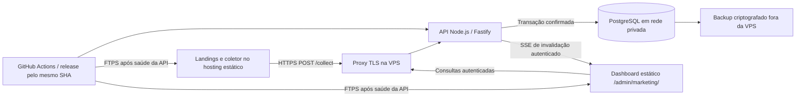

# API, banco, segurança e deploy do dashboard em tempo real

**Estado: especificação de planejamento.** Este documento não instala dependências, cria serviços, modifica a VPS ou altera o workflow. O trabalho autorizado nesta etapa é registrar o plano em Markdown. A implementação futura terá o seu próprio aceite.

Projeto: [Zoriek1/LandingPage](https://github.com/Zoriek1/LandingPage), Plante Uma Flor. Pesquisa e plano em **12/10/2026, horário de São Paulo**. Base auditada: commit [`2b2a937846e09e6603733fe7b725882503685d58`](https://github.com/Zoriek1/LandingPage/tree/2b2a937846e09e6603733fe7b725882503685d58). Hostnames e limites deste documento são propostas até o inventário da infraestrutura.

## 1. Resultado esperado e limites do escopo

O backend deve receber eventos explícitos do site, confirmar o que foi persistido, manter histórico e fornecer métricas e atualizações para um painel administrativo. O dashboard depende da coleta e do banco próprios; GA4 não é requisito nem fonte das métricas.

O sistema mede **sessões e ações observadas**, com consentimento válido e cobertura sujeita ao navegador e à rede. O servidor não consegue comprovar que todo evento público representa uma pessoa real. Também não confirma uma conversa ou uma venda apenas porque recebeu um clique no WhatsApp.

A primeira versão já exige persistência, autenticação, saneamento de dados, controle de abuso, backup com restauração verificada, migrações compatíveis e uma publicação conferida. A fase operacional posterior amplia capacidade, diagnósticos e recuperação; ela não adia esses requisitos básicos.

O MVP usa **um processo Node.js, PostgreSQL e SSE**. Redis, fila externa, múltiplas réplicas, stream com replay durável, gravação de sessões e integração financeira ficam fora dessa base inicial.

## 2. Arquitetura proposta



| Componente | Escolha inicial | Responsabilidade |
| --- | --- | --- |
| Site e dashboard | Hosting estático atual da Hostinger | Entregar HTML e assets separados, gerados no mesmo build |
| Runtime | Node.js em versão LTS mantida, com Node 24 como candidato a validar | Executar ingestão, autenticação, consultas e SSE |
| HTTP | Fastify em versão mantida compatível com o runtime | Schema de entrada, limites, respostas e middleware administrativo |
| Persistência | PostgreSQL em versão mantida, em container com volume | Eventos, sessões, pageviews, agregados e acesso administrativo |
| Acesso ao banco | Pool pequeno e SQL parametrizado | Reutilizar conexões e limitar o consumo da VPS |
| TLS e roteamento | Proxy reverso mantido, por exemplo Caddy ou Nginx | HTTPS, limites do corpo, encaminhamento e ajustes de SSE |
| Atualização | SSE + consultas HTTPS | Sinalizar mudança e obter o estado confirmado no banco |
| Publicação | GitHub Actions, imagem imutável e FTPS | Coordenar frontend e backend do mesmo commit |

### 2.1. Endereços e divisão de acesso

Endereços propostos, ainda sem provisionamento:

- Dashboard: `https://lpb.planteumaflor.com/admin/marketing/`.
- API: `https://analytics-api.planteumaflor.com`.
- Coleta pública: `POST /collect` no host da API.
- Todos os dados administrativos: prefixo `/admin/` no host da API.
- Saúde pública mínima: `/health` e `/health/ready` no host da API.

Usar um host para a API e outro para o HTML permite manter a landing na hospedagem atual. Ambos devem permanecer HTTPS no mesmo domínio registrável, para a proposta de cookie entre subdomínios funcionar como previsto. Se um deles mudar para outro domínio registrável, o desenho de sessão deve ser reavaliado antes da publicação.

O HTML do dashboard pode ser baixado sem autenticação. A proteção real fica nos endpoints que retornam dados, alteram estado ou abrem o stream. O build administrativo não inclui GTM, Meta Pixel ou o coletor das landings, e não entra no bundle público de marketing.

### 2.2. O que o inventário deve confirmar

Antes de implementar: plano contratado, CPU/RAM/disco disponíveis, sistema operacional, serviços já ativos na VPS, uso atual de portas 80/443, Docker/Compose existente, DNS, certificado, backups, acesso de deploy e volume observado de tráfego. A afirmação de que existem Node.js e VPS disponíveis não informa esses detalhes.

Não se deve reinstalar o sistema, aplicar um template que reconfigure a VPS ou substituir serviços existentes para seguir este plano. Se o inventário encontrar conflito, adaptar o proxy e os containers ao ambiente atual.

## 3. Contrato de ingestão V1

O contrato deve ser compartilhado entre coletor, API e fixtures de validação. A versão é `schema_version: 1`; o caminho inicial permanece `/collect`. Uma versão incompatível futura altera o contrato de forma explícita, sem mudar silenciosamente o significado de um campo.

### 3.1. Envelope do lote

```json
{
  "project_id": "plante-uma-flor-lp",
  "batch_id": "a182ccf1-d599-4f0c-8c84-ec4cb44145a8",
  "schema_version": 1,
  "events": [
    {
      "event_id": "709b465a-8c59-4130-b159-47b05e9a16e7",
      "schema_version": 1,
      "event_type": "page_view",
      "occurred_at": "2026-10-13T00:00:00.000Z",
      "session_id": "61b93559-ed5d-4321-81e9-cd1c91760ca5",
      "tab_id": "0a77d7fb-6fbe-44be-80a6-bd38c567c5f8",
      "pageview_id": "a3f0f8b2-b938-4c57-b129-c4ff2f77a06d",
      "release_sha": "2b2a937846e09e6603733fe7b725882503685d58",
      "path": "/",
      "props": {},
      "consent": {
        "analytics": "granted",
        "policy_version": "analytics-v1",
        "scope_id": "18bb391a-fbf8-4723-b402-8169f8dc98ac",
        "collected_at": "2026-10-12T23:59:59.000Z"
      }
    }
  ]
}
```

Os valores são exemplos sintéticos. `project_id` identifica o projeto público e **não é segredo**. `batch_id` identifica uma tentativa lógica de transporte para diagnóstico; a idempotência é sempre por evento. Um lote pode ser reorganizado ou reenviado parcialmente com outro `batch_id`, preservando os IDs dos eventos.

### 3.2. Campos e validação

| Campo | Regra V1 |
| --- | --- |
| `project_id` | Identificador cadastrado no servidor; nunca seleciona arbitrariamente um banco ou caminho de arquivo |
| `batch_id` | UUID gerado pelo coletor, sem significado de usuário |
| `schema_version` do lote | Inteiro exatamente `1` |
| `events` | Array de 1 a 50 elementos; IDs não se repetem dentro do mesmo lote |
| `event_id` | UUID nos eventos novos; também aceita ID legado ASCII de 8–128 caracteres, limitado a letras, números, `_` e `-` |
| `schema_version` do evento | Exatamente `1`, igual à versão do lote |
| `event_type` | Nome presente no catálogo de eventos aprovado; nomes e propriedades desconhecidos são rejeitados |
| `occurred_at` | Data ISO 8601 UTC válida; horário observado no navegador |
| `session_id`, `tab_id`, `pageview_id` | UUIDs aleatórios; representam sessão, aba e carregamento/navegação, sem identidade civil |
| `release_sha` | SHA completo do build; valor de desenvolvimento permitido somente fora de produção |
| `path` | Caminho canônico permitido, sem querystring, fragmento ou domínio; até 200 caracteres |
| `props` | Objeto com propriedades permitidas para aquele evento, tipos e limites individuais; sem texto livre |
| `consent.analytics` | Literal `granted`; qualquer outro estado não autoriza gravação comportamental |
| `consent.policy_version` | Versão conhecida da política/configuração de consentimento |
| `consent.scope_id` | UUID do ciclo de consentimento; novo aceite após revogação cria outro escopo |
| `consent.collected_at` | Horário da autorização conhecido pelo coletor; não comprova sozinho a validade jurídica ou autenticidade do consentimento |

Campos opcionais comuns, também validados: `lp_slug`, `entry_type` (`home`, `ad_lp`, `store`, `not_found`), `device_class` (`mobile`, `tablet`, `desktop`, `unknown`), `client_seq` inteiro não negativo e `attribution`. A atribuição contém somente `session_entry`, `current` e `referrer_host`, com chaves UTM autorizadas e domínio de origem saneado. `device_class` é uma classificação aproximada da largura da interface, não identificação precisa de hardware.

O campo `client_seq`, quando usado, auxilia a apresentação de ordem dentro de uma aba; não autoriza o servidor a assumir relógio correto ou ausência de eventos perdidos. Querystrings completas, URLs com parâmetros arbitrários, IDs brutos de publicidade, cookies GA, telefone, texto de mensagem, conteúdo de formulários e `token_rastreio` ficam fora do evento comportamental V1. A correlação de atendimento futura deve ter contrato separado.

O ID legado existe porque o projeto auditado gera IDs com `Math.random()` e horário em [`src/lib/tracking.ts`](https://github.com/Zoriek1/LandingPage/blob/2b2a937846e09e6603733fe7b725882503685d58/src/lib/tracking.ts#L93). Aceitá-lo permite reutilizar o ID de uma mesma ação já enviada aos destinos existentes. Isso não significa reaproveitar a regra de supressão de conversão de quatro horas para a coleta comportamental.

### 3.3. Limites iniciais

Os números abaixo são parâmetros de partida, não capacidade garantida. Devem ser medidos na fase inicial e ajustados pela carga real.

| Controle | Proposta inicial |
| --- | --- |
| Eventos por lote | Máximo 50 |
| Corpo completo | Máximo 32 KiB em UTF-8, após leitura limitada pelo servidor/proxy |
| Evento individual serializado | Máximo 4 KiB em UTF-8 |
| Profundidade JSON | Até 4 níveis úteis; propriedades sem objetos arbitrários |
| Compressão da coleta | Desabilitada no MVP; evita decompressionamento de corpos sem limite |
| Frequência usual do coletor | Flush a cada 2 segundos, adaptado quando há poucos eventos |
| Timeout usual do envio | 5 segundos, ajustável; timeout é resultado ambíguo |
| Tentativas no coletor | Até 5 tentativas totais, sendo o envio inicial e no máximo 4 reenvios, dentro de TTL de 10 minutos |
| Fila do coletor | Até 100 eventos ou 128 KiB, somente com consentimento ativo |
| Rate limit público por IP | Ponto inicial: 60 requisições/minuto com burst 20; revisar redes compartilhadas |
| Rate limit por sessão | Ponto inicial: 300 eventos/minuto; comportamento anormal é sinalizado |
| Limite global do projeto | Definir a partir do orçamento/carga de pico, antes da publicação |

Os limites de fila, descarte e transporte do navegador devem seguir o documento de coleta. IDs e consentimento são preservados na fila; revogação limpa o backlog daquele escopo. O servidor não deve armazenar 4 KiB de propriedades livres apenas porque esse é o limite de tamanho: cada tipo mantém sua allowlist.

### 3.4. Content-Type e envio no fechamento

O transporte normal é `fetch` com JSON e `Content-Type: application/json`. Caso o `sendBeacon` precise usar `text/plain;charset=UTF-8` para a compatibilidade comprovada no navegador, `/collect` pode aceitar esse formato **apenas como JSON com o mesmo schema, tamanho e limites**. Não aceitar formulário multipart, querystring de evento ou payload diferente para beacon. Essa compatibilidade deve ser decidida e testada na fase inicial, em vez de presumida.

Beacon retorna se o navegador enfileirou o envio; não retorna o ACK da API. O evento permanece potencialmente pendente para retry com o mesmo ID enquanto houver consentimento e TTL. Entrega residual após encerramento do navegador não é garantida.

### 3.5. Validação total e parcial

Regras do lote avaliadas antes de qualquer gravação:

1. Método, origem permitida quando aplicável, Content-Type e limite de bytes.
2. JSON bem formado, projeto conhecido, versão compatível e array permitido.
3. IDs repetidos dentro do lote: erro de envelope `DUPLICATE_EVENT_IDS`, zero gravação.
4. Limites e quotas de requisição.

Erro de envelope rejeita o lote inteiro. Se o envelope for válido, validar cada evento separadamente. Um evento com propriedade inválida não deve descartar os outros eventos válidos.

Um evento sem ID válido aparece no resultado pelo `index` enviado, com `event_id: null`. Essa regra torna a resposta determinística e permite ao coletor remover o item defeituoso sem inferir qual dos outros falhou. Eventos inválidos são rejeitados permanentemente para esse payload; somente uma ação nova gera ID novo.

### 3.6. ACK depois do commit

Resposta canônica de lote válido, incluindo validação parcial:

```json
{
  "schema_version": 1,
  "batch_id": "a182ccf1-d599-4f0c-8c84-ec4cb44145a8",
  "committed_at": "2026-10-13T00:00:00.350Z",
  "results": [
    {"index": 0, "event_id": "709b465a-8c59-4130-b159-47b05e9a16e7", "status": "accepted"},
    {"index": 1, "event_id": "aa7732c9-0d75-4259-afb0-1c775f5c03cf", "status": "duplicate"},
    {"index": 2, "event_id": "b456047c-15b5-4dfa-af13-0ce98c1e0693", "status": "rejected", "code": "INVALID_PROPERTIES"}
  ],
  "counts": {"accepted": 1, "duplicate": 1, "rejected": 1}
}
```

O exemplo de resultados ilustra um lote de três eventos. O exemplo de request anterior mostra somente um evento para facilitar a leitura.

- `accepted`: evento novo gravado e suas projeções consistentes, com transação confirmada.
- `duplicate`: o mesmo ID já está persistido com o mesmo conteúdo canônico; não foi contado novamente.
- `rejected`: o servidor não gravou aquele evento; `code` informa uma causa estável e não revela informações administrativas.
- `committed_at`: horário do servidor depois da conclusão; é referência de diagnóstico, não prova de quando a pessoa agiu.

HTTP `200` com resultados é retornado somente depois de confirmar a transação dos itens válidos. Se todos os itens forem inválidos ou duplicados, retornar o mesmo formato com zero eventos novos. Não usar `202 Accepted` para dar a entender que gravação futura equivale a persistência confirmada.

Se a transação falhar, retornar erro de disponibilidade e não declarar itens aceitos. Se houver commit e a conexão cair antes do ACK, o coletor não sabe o resultado: o reenvio dos mesmos IDs deve voltar como duplicata.

### 3.7. Códigos HTTP e reenvio

| Resultado | Resposta | Comportamento do coletor |
| --- | --- | --- |
| Lote concluído | `200` + ACK por posição/ID | Remover aceitos e duplicados; descartar rejeitados com diagnóstico agregado |
| JSON/envelope inválido | `400`, código estável | Não reenviar automaticamente o mesmo lote inválido |
| Origem/projeto não admitido | `403` | Interromper esse destino e sinalizar configuração |
| Corpo/lote acima do limite | `413` | Dividir lote quando possível; evento individual acima do limite é descartado |
| Content-Type não permitido | `415` | Corrigir transporte, sem loop de retry |
| Versão de contrato não suportada | `422` | Não reenviar a mesma versão; frontend anterior precisa continuar compatível durante rollout |
| Limite temporário | `429` + `Retry-After` | Aguardar e repetir IDs, respeitando TTL e tentativas |
| Erro temporário de servidor/banco | `500`, `502`, `503`, `504` | Backoff exponencial com jitter, mesmos IDs |
| Timeout, erro de rede ou conexão cortada | Sem ACK confiável | Resultado ambíguo: repetir IDs, sem gerar eventos novos |

Rejeições individuais incluem `INVALID_EVENT_ID`, `UNKNOWN_EVENT_TYPE`, `INVALID_PROPERTIES`, `INVALID_TIMESTAMP`, `INVALID_CONSENT`, `INVALID_PATH` e `ID_REUSE_MISMATCH`. Não retornar o payload original no erro. O coletor não deve transformar um evento rejeitado em um novo evento com outro ID para contornar a validação.

## 4. Idempotência, horário e projeções consistentes

### 4.1. Unicidade por projeto

Restrição única lógica: **`(project_id, event_id)`**. `batch_id`, sessão, horário e release não são a chave de deduplicação.

Guardar uma impressão digital do payload canônico saneado, com algoritmo mantido como SHA-256, para detectar o reaproveitamento de um ID em outra ação. Ordenar chaves na serialização canônica e excluir campos acrescentados pelo servidor. O esquema de canonicalização é versionado com o contrato.

Se o ID já existe e a impressão digital coincide, responder `duplicate`. Se o ID já existe com outro conteúdo, responder `rejected / ID_REUSE_MISMATCH`; não substituir o evento original. Os IDs aleatórios e a hash não tornam o evento público autenticado.

### 4.2. Uma transação para evento e efeitos

Fluxo lógico da persistência, ainda sem código de aplicação:

1. Validar e sanear os itens.
2. Abrir transação no PostgreSQL.
3. Inserir eventos válidos com restrição única e obter somente os IDs realmente novos.
4. Consultar o conteúdo canônico dos IDs conflitantes para distinguir duplicata de reutilização indevida.
5. Atualizar sessões, pageviews e agregados **apenas** a partir dos eventos novos retornados pela inserção.
6. Atualizar a revisão do projeto na mesma transação, se houver eventos novos.
7. Confirmar commit.
8. Montar o ACK e sinalizar invalidação SSE após o commit.

Conflitos simultâneos são arbitrados pela restrição do banco; não fazer somente “consultar antes e depois inserir”, porque duas requisições podem passar pela consulta. Upserts de agregados incrementam os contadores de forma atômica, com ordens de acesso estáveis e repetição limitada da transação em caso de deadlock/erro serializável.

Se o banco recusar a transação, os efeitos são revertidos juntos. Se o processo cair depois do commit e antes de emitir SSE, os dados continuam corretos; a reconciliação do painel corrige a ausência da notificação.

### 4.3. Tempo e eventos atrasados

Armazenar separadamente:

- `occurred_at`: horário informado pelo navegador.
- `received_at`: horário de recepção do servidor.
- `effective_at`: horário usado nas métricas após validação da regra de relógio.
- `clock_quality`: por exemplo `client_valid`, `server_fallback` ou `late`.

Proposta inicial: considerar o horário do navegador coerente se não estiver mais de 2 minutos no futuro nem mais de 24 horas no passado em relação à recepção. Fora dessa janela, conservar o horário informado como evidência e usar recepção nas métricas, com sinalização de qualidade. Timestamp impossível ou malformado é rejeitado. Essas janelas devem ser validadas com o TTL real e a finalidade do relatório.

Eventos tardios podem alterar um agregado de um minuto anterior. Contadores não devem assumir que a chegada é cronológica. Na sessão, primeira atividade usa mínimo; última atividade usa máximo; página atual é trocada somente por uma visita/atividade mais recente segundo regra coerente. Não abrir novamente uma presença “online” apenas porque chegou uma ação antiga.

Presença depende de um sinal recente de visibilidade/heartbeat, não de qualquer evento recebido agora. Um retry de clique antigo não atualiza presença. Para relógio inconsistente, a recepção serve às métricas com sinalização de qualidade; não se deve inferir horário real da ação nem prolongar a sessão por esse fallback. A regra do heartbeat precisa distinguir a medição corrente dos intervalos reenviados, usando os campos do contrato e o TTL do coletor.

### 4.4. Presença, sessão e tempo engajado

Parâmetros alinhados ao plano de coleta:

- Heartbeat: a cada 15 segundos enquanto a página está visível, conforme o estado do coletor.
- Presença observada: expira 60 segundos depois do último sinal válido de presença recente.
- Sessão: nova após 30 minutos sem ação do usuário; heartbeat sozinho não estende esse prazo.
- Engajamento: página visível e interação nos últimos 30 segundos, com incremento limitado ao intervalo real observado.
- Incremento de tempo por sinal: não aceitar mais de 15.000 ms por intervalo normal; validar os campos do tipo de evento.

`last_seen_at`, `last_user_activity_at` e tempo engajado são campos distintos. Uma página visível, abandonada no monitor, pode manter um sinal de presença por um período sem somar tempo engajado nem perpetuar a sessão de marketing.

No contrato das consultas, `online_sessions` significa presença visível observada no TTL de 60 segundos. `active_sessions`, se oferecido como métrica separada, exige página visível e ação elegível nos últimos 30 segundos. O painel usa esses nomes com denominadores e limiares declarados; presença não é sinônimo de interação recente.

O contrato inicial usa sessão por aba, com identidades próprias; outra aba pode representar outra sessão. Não somar presença como pessoas únicas nem inferir que sessões diferentes pertencem à mesma pessoa. Tempo engajado é consolidado por pageview e sessão da aba, com intervalos sem sobreposição na mesma instância. Totais entre abas são uso observado acumulado, não duração única de uma pessoa. Clonagem de aba e restauração do navegador precisam ser verificadas pela coleta para evitar reutilização acidental de identidade.

## 5. Modelo lógico do PostgreSQL

As tabelas abaixo descrevem a estrutura esperada; não são DDL executado. Escolher versão, biblioteca de migração e nomes físicos durante a implementação, conservando as invariantes.

### 5.1. `projects`

| Campo lógico | Uso |
| --- | --- |
| `project_id` | Identificador público registrado |
| `name`, `enabled` | Nome e estado de coleta |
| `allowed_origins`, `allowed_paths`, `policy_versions` | Configuração validada, alterável somente pelo operador |
| `data_revision` | Contador serializado de mudança, atualizado na transação de ingestão |
| `created_at`, `updated_at` | Auditoria técnica |

O contador `data_revision` é obtido por atualização atômica da linha do projeto. Assim a revisão persistida e o snapshot podem ser comparados. Esse ponto serializa uma operação por lote, aceitável como proposta para o MVP; medir contenção antes de escalar.

### 5.2. `events`

| Campo lógico | Uso |
| --- | --- |
| `id` interno | Identidade numérica para paginação; não é ordem global de commit |
| `project_id`, `event_id` | Identificação e unicidade de deduplicação |
| `schema_version`, `event_type`, `release_sha` | Contrato, significado e versão do código |
| `occurred_at`, `received_at`, `effective_at`, `clock_quality` | Tempo e qualidade de relógio |
| `session_id`, `tab_id`, `pageview_id`, `client_seq` | Relação entre ações |
| `path`, `lp_slug`, `entry_type`, `device_class` | Dimensões de análise autorizadas |
| `attribution` | UTMs saneadas e host de referência permitido |
| `props` | JSONB estritamente validado por evento |
| `consent_scope_id`, `consent_policy_version`, `consent_collected_at` | Escopo de coleta e política aplicada |
| `payload_fingerprint` | Detecção de duplicata/reutilização do ID |
| `traffic_class` | `observed`, `suspected_bot` ou `synthetic`, com regra documentada |

A identidade interna crescente pode ser alocada antes de um commit e ter lacunas. Portanto não usar `MAX(id)` como prova de que todos os eventos anteriores já foram confirmados.

### 5.3. `sessions`

Chave lógica: `(project_id, session_id)`.

Guardar primeira visita, primeira e última ação do usuário, última recepção, origem de entrada autorizada, último pageview válido, sinais de presença e rollups necessários ao painel. Consentimento e informações de relógio permanecem rastreáveis pelos eventos. Atualizações com eventos fora de ordem não podem regredir a última ação.

Não guardar nome, telefone, IP permanente ou identificação de CRM nessa tabela no V1. O caminho de atribuição não usa IDs GA.

### 5.4. `pageviews`

Chave lógica: `(project_id, pageview_id)`.

Relaciona sessão, aba, rota, entrada, release, começo/fim observado, último sinal de visibilidade, profundidade máxima de scroll e tempo ativo validado. Pode nascer provisoriamente caso um heartbeat chegue antes de `page_view`; a chegada posterior completa os campos sem somar uma segunda visita.

Contar pageviews a partir da ação `page_view` persistida, e não de qualquer linha provisória. A chave também impede que retries contem uma visita novamente. Rotas SPA e prerender usam o mesmo significado do contrato.

### 5.5. `minute_metrics`

Chave lógica: projeto, minuto UTC e conjunto **limitado** de dimensões aprovadas. Valores iniciais: pageviews, ações por tipo, exposição, cliques e tempo engajado; outras métricas entram quando tiverem regra de atualização definida.

Regras necessárias:

- Incrementar apenas pelos eventos novos da transação.
- Não somar contagens distintas por minuto para dizer “sessões distintas no dia”. A mesma sessão pode existir em vários minutos.
- Consultas de sessões distintas usam `sessions`/eventos retidos ou um rollup diário de conjunto definido na fase de agregação.
- Não combinar arbitrariamente toda UTM, path, produto, variante e ID em uma chave; isso gera explosão de cardinalidade.
- Normalizar dimensões para IDs conhecidos, valores limitados e categoria `other` quando a política exigir.
- Eventos sintéticos e tráfego classificado ficam separados das métricas comerciais padrão.

Agregados de longa retenção não contêm `session_id`, `event_id`, `consent_scope_id`, token ou texto arbitrário. UTMs podem conter dados pessoais se vierem de campanhas inadequadas; limitar e sanear essas dimensões antes de considerar o agregado anonimizado.

### 5.6. `admin_users`, `admin_project_access` e `admin_sessions`

`admin_users` mantém ID, login definido pelo operador, hash de senha ou identidade da solução de autenticação mantida, estado, tentativas e timestamps necessários. O administrador é provisionado fora do bundle; não oferecer cadastro público no MVP.

`admin_project_access` estabelece quais projetos o usuário pode consultar e seu papel. Mesmo que o MVP tenha um projeto e um administrador, a API valida esse vínculo e não aceita trocar `project_id` para consultar outro tenant.

`admin_sessions` guarda hash de um token opaco aleatório, usuário, expiração absoluta, atividade, revogação e material de CSRF. Nunca guardar o token de sessão em texto livre nos logs. Expiração proposta: 8 horas absolutas e 30 minutos de inatividade administrativa; confirmar necessidade operacional na implementação.

Preferir uma biblioteca de autenticação mantida, compatível com o cookie e Fastify, em vez de inventar protocolo de login. Se senha local for selecionada, usar algoritmo apropriado e mantido, como Argon2id, parâmetros calibrados na VPS, comparação segura e limitação de tentativas.

### 5.7. Índices iniciais e revisão

| Índice lógico | Consulta/invariante |
| --- | --- |
| Único `events(project_id, event_id)` | Idempotência |
| `events(project_id, received_at DESC, id DESC)` | Feed recente e histórico por recepção |
| `events(project_id, session_id, effective_at, id)` | Jornada de sessão |
| `events(project_id, path, effective_at)` | Análise de página por período |
| `events(project_id, event_type, effective_at)` | Funil/eventos por período |
| Único em sessão/pageview | Projeções sem duplicatas |
| `sessions(project_id, last_seen_at)` | Presença recente |
| Chave única dos agregados | Upsert por minuto/dimensão |
| `admin_sessions(token_hash)` e expiração | Sessão e limpeza |

Não criar um índice GIN amplo em todo JSONB por padrão. Adicionar índices de produto/campanha a partir de consultas e `EXPLAIN` medidos. Particionamento e separação analítica ficam para volume que justifique a manutenção extra. Limpeza em lotes e manutenção do PostgreSQL precisam evitar transações longas.

## 6. API administrativa e consultas

Todas as rotas desta seção exigem sessão válida e autorização do projeto, salvo login e verificação pública de saúde. Dados de sessão, consultas e stream usam `Cache-Control: no-store`. Respostas de erro não incluem SQL, stack trace, senha, token ou payload privado.

### 6.1. Catálogo de endpoints

| Endpoint proposto | Função e fase |
| --- | --- |
| `POST /admin/login` | Login, fase A |
| `GET /admin/session` | Usuário/projetos autorizados, validade e CSRF, fase A |
| `POST /admin/logout` | Revogar sessão e encerrar streams associados, fase A |
| `GET /admin/overview` | Snapshot de totais e presença, fase A |
| `GET /admin/events` | Feed recente e histórico paginado, fase A |
| `GET /admin/sessions` | Lista pseudônima de sessões observadas, fases A/B |
| `GET /admin/sessions/:session_id/journey` | Jornada paginada, fase B |
| `GET /admin/reports/engagement` | Exposição, scroll e tempo ativo, fase B |
| `GET /admin/reports/products` | Produtos, filtros e escolhas, fase B |
| `GET /admin/reports/campaigns` | Páginas, UTMs e variantes, fase B |
| `GET /admin/reports/actions` | CTAs e etapas medidas, fases A/B |
| `GET /admin/stream` | Invalidação SSE, fase A |
| `POST /admin/exports` | Exportação com escopo, limite e auditoria, fase C |
| `GET /admin/diagnostics` | Qualidade operacional restrita, fase C |
| `GET /health` | Processo e versão, fase A |
| `GET /health/ready` | Readiness do banco/contrato, fase A |

### 6.2. Filtros e limites

Formato inicial: `project_id`, `from`, `to`, `path`, `event_type`, `utm_source`, `utm_campaign`, `variant_id`, `product_id`, `device_class` e `limit`, somente quando o relatório comportar o filtro. Datas são ISO UTC; `from` inclusivo e `to` exclusivo. A interface converte a seleção São Paulo para UTC e mostra o fuso.

Validar o projeto pela sessão, nomes por allowlist, limites de comprimento, intervalo máximo consultável e `limit` de 1–100, com padrão 50 no histórico. Não interpolar filtros em SQL. Responder `400` para combinações inválidas ou intervalos maiores que a política permitida, com orientação curta.

Métricas devolvem nome, numerador, denominador, período, filtros e fonte. Um clique em WhatsApp aparece como clique, sem rótulo de conversa confirmada. Nenhuma consulta inventa gasto ou receita que o banco não recebeu de uma integração futura.

### 6.3. Snapshot de visão geral

Exemplo conceitual de resposta:

```json
{
  "schema_version": 1,
  "project_id": "plante-uma-flor-lp",
  "data_revision": 128,
  "generated_at": "2026-10-13T00:00:02.000Z",
  "window": {"from": "2026-10-12T03:00:00.000Z", "to": "2026-10-13T03:00:00.000Z"},
  "filters": {},
  "metrics": {"pageviews": 80, "observed_sessions": 51, "online_sessions": 4, "whatsapp_clicks": 7},
  "coverage": {"source": "own_collector", "traffic_class": "observed"},
  "freshness": {"last_received_at": "2026-10-13T00:00:00.300Z"}
}
```

Snapshot composto é lido em uma transação de leitura consistente, por exemplo `REPEATABLE READ`, para que revisão e totais correspondam ao mesmo estado. TTL de presença é calculado no horário atual do servidor e informado na documentação da métrica.

Se um componente usar outro endpoint, mostrar seu próprio `generated_at`. A interface não deve apresentar várias respostas de períodos diferentes como um único estado exato.

### 6.4. Histórico e paginação

Cursor opaco e validado representa a última tupla `(received_at, id)` da página, os filtros e um horizonte superior `as_of`. Usar keyset pagination em vez de offsets altos. O cursor não substitui a autorização: todo pedido valida projeto e filtros novamente.

Resposta conceitual: `items`, `next_cursor`, `has_more`, `as_of`, `generated_at`, `data_revision` e filtros aplicados. O histórico principal usa recepção para paginação estável; a jornada pode apresentar horário efetivo e sinalizar chegada tardia.

O horizonte exclui eventos recebidos depois do início da consulta. Transações em andamento ainda podem gerar mudanças na borda; o MVP não promete exportação com snapshot perfeito entre várias requisições. Recarregar do início reconcilia eventos recentes. Uma exportação consistente futura precisa executar uma leitura com escopo de snapshot próprio, em tarefa autorizada e limitada.

### 6.5. Erros de acesso

- `401`: sessão ausente, expirada ou revogada; painel encerra stream e volta ao login.
- `403`: sessão válida, mas projeto ou operação não autorizado.
- `400`: filtro ou cursor inválido.
- `429`: consultas ou streams acima do limite.
- `503`: dependência temporariamente indisponível, preservando a última visualização com indicação de atraso.

Respostas de saúde públicas são mínimas. `/health` informa apenas estado e release; `/health/ready` responde `200` quando o banco e as migrações necessárias estão prontos e `503` caso contrário. Detalhes de conexões, tabelas e erros ficam em logs restritos.

## 7. Tempo real com SSE e reconciliação

SSE envia **invalidações**, não deltas que o navegador precisa somar. A fonte final permanece o snapshot do banco.

### 7.1. Conexão e mensagens

`GET /admin/stream?project_id=plante-uma-flor-lp`, autenticado pelo cookie administrativo. O navegador usa `EventSource` com credenciais. Nenhum token permanente vai na URL.

Tipos de mensagem planejados:

- `ready`: conexão validada; informa release, revisão e horário do servidor.
- `invalidate`: há alteração confirmada no projeto; informa `data_revision` e horário.
- `auth_expiring`, se a implementação justificar: aviso sem renovação automática ilimitada.
- Comentários keepalive: manter conexão, sem serem eventos comerciais.

O SSE não envia nome/telefone, payload completo do evento nem dados de outros projetos. Mesmo um administrador autenticado só abre streams para os projetos autorizados.

### 7.2. Fluxo do painel

1. Abrir stream e carregar snapshot inicial.
2. Agrupar invalidações por 250–500 ms e permitir no máximo uma consulta em andamento por bloco.
3. Comparar a revisão do resultado com a revisão observada; se houver alteração pendente, recarregar mais uma vez.
4. Ao conectar/reconectar, sempre consultar snapshot novo.
5. Reconciliar periodicamente, proposta inicial a cada 30 segundos, mesmo com SSE saudável.
6. Em falha continuada do stream, consultar a cada 5 segundos com backoff e mostrar modo de recuperação.
7. Voltar ao SSE sem manter dois ciclos de atualização concorrentes.

O contador `data_revision` representa estado persistido do projeto. Se houver um `id`/sequência de mensagem SSE, ele é só identidade da notificação daquela instância. `Last-Event-ID` e reconexão automática não provam replay durável. O MVP não depende de recuperar cada notificação; depende de recuperar o estado no banco.

### 7.3. Configuração do servidor e proxy

- `Content-Type: text/event-stream`, cache desabilitado e sem buffering/compressão indevida no proxy.
- Keepalive proposto a cada 15–25 segundos; timeouts maiores que esse intervalo.
- Limites de conexões por administrador/projeto e total do processo, calibrados no inventário.
- Stream assíncrono não reserva uma conexão PostgreSQL durante toda a sessão.
- Remover listeners, timers e referências ao socket no fechamento/erro.
- Validar expiração da sessão periodicamente e fechar conexões revogadas, inclusive após logout.
- No desligamento, parar novas conexões, concluir pedidos breves e fechar streams para reconexão.
- Buffer por cliente limitado; cliente lento é desconectado e reconciliará depois.

Um processo Node pode manter as assinaturas em memória porque elas são temporárias; eventos, revisão, autorização e snapshots ficam no banco. Reiniciar perde assinaturas, não histórico. Mais de uma réplica exigirá transporte de invalidação entre instâncias ou estratégia diferente; não adicionar esse componente antes de medir a necessidade.

### 7.4. Metas de atraso

Meta de experiência: ações usuais aparecem em 2–5 segundos, dependendo do lote e da rede. Objetivo técnico a medir: p95 de até 5 segundos entre persistência e apresentação. Medir também ação → recepção → commit → snapshot → renderização; atingir apenas o último trecho não prova latência total.

O painel mostra última atualização, última recepção observada e estado da conexão. Não chamar uma tela desconectada de “ao vivo” sem indicar atraso. Essas metas não são SLA contratado ou capacidade já comprovada.

## 8. Autenticação, autorização, CORS e CSRF

### 8.1. Cookie administrativo

Proposta de cookie: `__Secure-puf_admin`, token opaco aleatório, `Secure`, `HttpOnly`, `SameSite=Lax`, **host-only**, `Path=/admin/`. Não definir `Domain=.planteumaflor.com`, para que o cookie não circule pelos hosts das landings.

O prefixo `__Host-` não é usado porque exige `Path=/`, diferente do escopo administrativo escolhido. O prefixo `__Secure-` é compatível com o caminho restrito.

O cookie da API não é acessível ao React. O frontend recebe apenas informação da sessão e um token CSRF transitório pelo endpoint autorizado; não grava senha ou token de sessão em `localStorage`. O endpoint `/collect` não necessita nem recebe o cookie por estar fora de `/admin/`.

### 8.2. CORS exato

Para `/admin/`, liberar somente os origins HTTPS do dashboard efetivamente aprovados. Por exemplo, `https://lpb.planteumaflor.com`; `https://www.planteumaflor.com` só entra se realmente hospedar uma entrada administrativa. O origin com e sem `www` são valores diferentes.

Usar `Access-Control-Allow-Credentials: true`, origin exato e `Vary: Origin`. Não usar `*` com credenciais, não refletir qualquer Origin e não liberar todos os subdomínios por regex vaga. Autorizar métodos e headers necessários, incluindo o header CSRF. Ambientes locais/staging têm configuração própria, sem misturar HTTP local aos origins de produção.

Para `/collect`, CORS permite os origins públicos registrados do site e somente os métodos/headers necessários. Isso restringe uso no navegador; um cliente externo pode forjar Origin ou chamar HTTP diretamente. CORS não autentica eventos.

### 8.3. CSRF e sessão

Login deve exigir JSON, header explícito de solicitação do dashboard e Origin permitido, com preflight quando estiver entre origins. O erro de login é genérico e as tentativas são limitadas. A proteção de login não depende de confiar apenas no `SameSite`.

Após autenticação, operações de alteração, incluindo logout e exportação por POST, exigem token CSRF ligado à sessão e validação de Origin. `GET /admin/session` devolve o token transitório sob autenticação; CORS impede leitura por origin externo. O token não substitui autorização do usuário.

SSE e consultas de leitura ainda validam sessão/projeto e Origin previsto. Logout revoga o registro da sessão no servidor, limpa o cookie com os mesmos atributos e fecha streams relacionados. Troca de senha, desativação do usuário ou revogação também invalida sessões.

### 8.4. Administração inicial

O MVP prevê um administrador provisionado pelo operador, sem formulário público de cadastro. Registrar login, logout, falhas e exportações com IDs técnicos e sem senha. Recuperação de acesso é procedimento de operador documentado; não deixar uma senha padrão ou endpoint de bootstrap ativo em produção.

MFA e gestão de equipe podem ser acrescentados com a solução de autenticação escolhida, mas não justificar uma primeira versão sem controle real de acesso. Se o ambiente já possuir identidade administrativa adequada, avaliar a integração antes de criar outro mecanismo.

## 9. Proteção da ingestão e qualidade dos dados

### 9.1. Coletor público

Uma chave incorporada no JavaScript, URL pouco divulgada, CORS ou referrer não comprovam autenticidade. Qualquer pessoa pode analisar o site e produzir chamadas parecidas. A proteção combina limites, schema, quotas, deduplicação, detecção de padrões e controle operacional.

- Proxy limita corpo e conexões; API limita eventos, bytes, tipos, profundidade e campos.
- Aplicar rate limit por IP, sessão e projeto, com atenção a redes compartilhadas.
- Endereço IP pode ser usado transitoriamente para limitação, com TTL curto e sem persistir em eventos.
- Header de IP encaminhado só é confiável quando vem do proxy configurado; não aceitar qualquer `X-Forwarded-For` externo.
- Eventos têm classificações técnicas `synthetic`/`suspected_bot` quando houver regra verificável; a classe normal não equivale a “humano comprovado”.
- Quota global e proteção contra falta de disco limitam dano operacional; ao atingir capacidade, responder `429`/`503` com diagnóstico, sem confirmar o que não foi salvo.

Não colocar segredo de HMAC ou credencial administrativa no bundle para tentar resolver autenticidade. Assinatura verificável de resultados de CRM, quando existir, usa segredo no servidor e contrato separado.

### 9.2. Dados sensíveis e logs

Não registrar corpos completos no logger HTTP. Logs devem conter request ID, rota, status, duração, contagens agregadas, código de erro, release e projeto autorizado. Headers de cookie, autorização, senha e payloads são redigidos. A query da URL também requer saneamento.

URLs e UTMs são validadas antes da persistência. A API rejeita propriedades não previstas, em vez de armazená-las em uma coluna “extra” sem controle. Dados pseudônimos continuam sujeitos à política de privacidade e à LGPD; não rotular todo o histórico como anonimizado.

### 9.3. Consentimento e direitos

A proposta V1 é coleta comportamental após consentimento analítico válido integrado à CMP. Recusa e revogação suspendem coleta e eliminam fila local do escopo. O backend rejeita evento sem estado e política compatíveis; isso é validação de contrato, não substituição da CMP.

Definir finalidade, versão de política, retenção, titulares atendidos, contato e procedimento de acesso/eliminação antes da operação. Uma solicitação de eliminação precisa identificar o escopo com meios adequados; não prometer localizar todas as ações de uma pessoa sem identificador verificável.

Se backups tiverem eventos do escopo eliminado, manter registro operacional mínimo da eliminação e reaplicá-la ao restaurar, até o backup expirar. Agregados só podem conservar dados se realmente não permitirem associação individual e a finalidade justificar a retenção.

## 10. Infraestrutura da VPS e ciclo de vida

### 10.1. Serviços Compose planejados

O Compose futuro descreverá proxy, API e PostgreSQL, sem incluir arquivos de frontend na base de dados. Isso é um plano de serviços; nenhum YAML de implantação é criado nesta etapa.

| Serviço | Exposição e persistência |
| --- | --- |
| Proxy HTTPS | Portas públicas 80/443; certificado e configuração persistentes |
| API | Porta interna acessível pelo proxy; usuário de processo sem privilégio; configuração no servidor |
| PostgreSQL | Somente rede privada dos containers ou loopback controlado; volume persistente |
| Migração | Job único e controlado; não rodar concorrente em cada requisição |
| Backup/limpeza | Tarefas agendadas verificadas; destino de backup fora do disco principal |

Porta PostgreSQL não é exposta na internet. Conta da API tem permissões de runtime; migração e backup podem usar identidades próprias. Segredos não são incluídos na imagem, no Git, no `dist/` ou em variáveis públicas Vite.

Definir healthchecks, política de reinício, limites de recursos calibrados, rede interna, volumes e rotação de logs. Reservar disco para banco, WAL, backups temporários e logs. Volume persistente não é backup e não deve ser removido durante troca de imagem.

### 10.2. Configuração pública e segredos

Nomes sugeridos, sem valores, sujeitos ao caminho de deploy escolhido:

| Nome sugerido | Local e finalidade |
| --- | --- |
| `VITE_ANALYTICS_API_URL` | Configuração pública da origem da API |
| `VITE_ANALYTICS_PROJECT_ID` | Identificador público do projeto |
| `RELEASE_SHA` | Imagem/build/saúde; valor não secreto |
| `DATABASE_URL` | Somente servidor, credencial do runtime |
| `MIGRATION_DATABASE_URL` | Job de migração com escopo adequado |
| `ADMIN_SESSION_SECRET` | Se a biblioteca exigir segredo adicional; somente servidor |
| `ADMIN_ALLOWED_ORIGINS` | Configuração administrativa do servidor |
| `COLLECT_ALLOWED_ORIGINS` | Configuração de coleta do servidor |
| `FTP_SERVER`, `FTP_USERNAME`, `FTP_PASSWORD` | Secrets atuais do GitHub para FTPS |
| `VPS_DEPLOY_HOST`, `VPS_DEPLOY_USER`, `VPS_DEPLOY_KEY`, `VPS_KNOWN_HOSTS` | GitHub, se escolhido SSH restrito |
| `HOSTINGER_API_TOKEN`, `HOSTINGER_VM_ID` | GitHub, se escolhida Action/API Hostinger; confirmar nomes da versão fixa |
| `REGISTRY_USERNAME`, `REGISTRY_TOKEN` | Registry privado, se necessário |
| `BACKUP_DESTINATION`, `BACKUP_ENCRYPTION_KEY` | Operação do servidor; destino e proteção fora do bundle |

Não fornecer simultaneamente todas as credenciais se o caminho escolhido usa apenas SSH ou apenas a API Hostinger. Usar privilégios mínimos, pinagem de host SSH e registro de rotação. Máscara do GitHub em logs não autoriza imprimir segredos.

### 10.3. Pool e desligamento

Pool inicial pequeno, por exemplo 5–10 conexões do processo API, depois de verificar recursos e concorrência; o número é proposta. Definir timeout de conexão, consulta e transação. Stream SSE não segura conexão do pool.

No rollout: readiness passa a indisponível, parar novos pedidos, concluir transações em curso dentro do timeout, encerrar streams, fechar pool e desligar. Se o processo cair, o PostgreSQL arbitra commit/rollback e o coletor recupera ambiguidades por idempotência.

## 11. Backup, retenção e recuperação

### 11.1. Política inicial proposta

| Dado | Prazo/rotina de partida |
| --- | --- |
| Eventos detalhados e pageviews | 90 dias, sujeito à finalidade e política final |
| Sessões pseudônimas | Compatíveis com os 90 dias de detalhe; não reter indefinidamente |
| Agregados sem associação individual | Até 12 meses, com dimensões saneadas e limitadas |
| Sessões administrativas | Expiração curta e limpeza periódica; auditoria com política própria |
| Backup diário de banco | Retenção inicial 7 diários + 4 semanais, armazenados fora da VPS e criptografados |
| Logs operacionais | Retenção limitada, proposta 14–30 dias sem payload sensível |

Esses prazos são propostas de engenharia/produto, não determinação automática da lei. Validar política definitiva antes de operar. Não guardar identificadores individuais nos agregados de 12 meses para driblar a expiração dos eventos.

### 11.2. Primeira versão

A fase A já deve demonstrar um backup, restaurá-lo em banco separado e confirmar consistência básica: eventos, sessões, agregados, autorização e migrações. O arquivo fica fora do volume principal, com acesso restrito; a chave de criptografia precisa ser recuperável independentemente da VPS.

Objetivos iniciais a confirmar com o negócio: **RPO até 24 horas**, com backup diário, e **RTO até 4 horas**, após exercício de restauração. Esses valores não são garantidos sem medir a recuperação no ambiente. RPO menor exige outra estratégia, como backup mais frequente ou recuperação por WAL; estimar na fase C.

### 11.3. Procedimento planejado de restauração

1. Identificar incidente, release e último backup válido; suspender coleta se necessário.
2. Provisionar volume/banco separado sem destruir a base existente.
3. Restaurar backup e conferir migração, integridade, contagens de amostra e autorização.
4. Reaplicar eliminações pendentes e política de retenção.
5. Executar consultas e ingestão sintética isolada.
6. Promover o banco restaurado somente depois da validação e registrar a janela de dados perdida.
7. Retomar API, reconciliar painel e acompanhar erros/duplicatas.

Rollback de aplicação não é restauração de banco. Um erro de imagem pode ser revertido sem apagar eventos válidos recentes. Uma restauração antiga pode perder eventos; nunca a apresentar como procedimento neutro de deploy.

### 11.4. Limpeza e reconciliação

Tarefas agendadas com horário, resultado, duração e falhas registradas removem dados vencidos em lotes pequenos. Agregação de longo prazo ocorre antes da remoção somente para dimensões aprovadas. Limpeza não segura locks longos enquanto o site recebe eventos.

Reconciliação compara amostras/intervalos de agregados com eventos ainda retidos, corrige divergências com execução controlada e não conta duplicatas. Após apagar eventos de 90 dias, já não é possível reconstruir todos os relatórios detalhados daquele período; o painel explica esse limite.

## 12. Deploy coordenado do mesmo commit

O projeto auditado publica `dist/` por FTPS em push na `main`, sem API, banco ou verificação de saúde. A proposta amplia esse fluxo; não exige migrar o site para a VPS.

### 12.1. Pipeline planejado

1. **Validação:** types, lint, testes relevantes, build/prerender e verificação da separação do bundle administrativo.
2. **Artefatos:** gerar frontend e imagem backend imutáveis a partir do mesmo SHA; guardar manifesto de release e digests.
3. **Migração:** adquirir lock do migrador e aplicar apenas mudanças compatíveis com a aplicação anterior.
4. **Backend:** publicar a imagem no VPS pelo caminho aprovado, mantendo referência da release anterior.
5. **Saúde:** aguardar `/health/ready`, conferir `release_sha`, contrato suportado, banco/migrações e conectividade HTTPS.
6. **Frontend:** somente com backend pronto, enviar assets e depois HTMLs por FTPS; manter chunks antigos pelo período de transição definido.
7. **Smoke check:** abrir entrada pública e administrativa, validar ingestão sintética isolada e bloqueio de consulta sem login.
8. **Registro:** salvar resultado, SHA dos dois componentes, migração e forma de retorno à release anterior.

Adicionar controle de concorrência do deploy para evitar duas publicações da `main` disputando servidor e arquivos. Não cancelar arbitrariamente um job em meio a migração ou FTPS; a política deve proteger essas etapas.

### 12.2. Mesmo workflow não é atomicidade

API e hosting estático são destinos distintos. O backend pode ser publicado e o FTPS falhar parcialmente; visitantes também podem continuar com JavaScript da versão anterior no cache.

Por isso:

- Backend novo atende coletor anterior durante a janela de compatibilidade.
- Contrato V1 permanece estável enquanto houver clientes V1 ativos.
- Assets com hash são enviados antes dos HTMLs que os referenciam.
- HTML tem cache curto/revalidação; assets imutáveis têm política correspondente.
- Conservar chunks antigos por uma janela acordada, com limpeza independente.
- Verificar comportamento real da ferramenta FTPS; sucesso parcial não vira release concluída.
- O frontend possui recuperação de falha de importação compatível com o comportamento do Vite.

Não há promessa de deploy atômico entre os dois destinos. O requisito “junto do projeto e deploy junto” é atendido por repositório, versão e pipeline coordenados.

### 12.3. Hostinger Action ou SSH

A pesquisa encontrou divergência: um artigo da Hostinger cita a Action antiga `hostinger/deploy-action@v1`, enquanto o repositório oficial atual mostra `hostinger/deploy-on-vps@v2`. Antes de implementar, revisar a versão e **fixar um commit validado**, incluindo Actions de terceiros.

O código oficial consultado em `main` inicia o deploy pela API. Isso não demonstra que a aplicação ficou saudável. Portanto o health check externo, a conferência do SHA e a validação de readiness continuam necessários, mesmo que a Action termine com sucesso. A versão e os parâmetros podem mudar depois desta pesquisa.

Alternativa: SSH com usuário de deploy dedicado, host key fixada e comando/escopo restrito para atualizar imagem/Compose e verificar saúde. Para repositório privado, deploy key somente leitura e limitada ao repositório. Não usar acesso root amplo quando o procedimento puder ser restrito.

### 12.4. Migrações e rollback

Estratégia **expandir → migrar dados → retirar**:

1. Adicionar tabelas/colunas compatíveis, inicialmente opcionais quando necessário.
2. Publicar código que entende estado antigo e novo.
3. Executar backfill controlado, com métricas e limite de carga.
4. Após janela de compatibilidade e validação, retirar leitura/escrita antiga em outra release.
5. Só depois remover coluna/índice obsoleto com análise de lock e plano específico.

Migrações são versionadas, únicas, revisadas e executadas por job controlado com lock. Não rodar uma migração concorrente por instância ou derrubar schema para “corrigir” produção.

Para falha de backend: restaurar imagem anterior e manter schema compatível. Para falha de frontend: restaurar artefato anterior sem remover assets ainda usados. A release registra qual combinação é compatível. Se uma migração destrutiva impedir rollback, sua implantação exige outro plano e não cabe no fluxo inicial.

### 12.5. Commit de planejamento com skip CI

O commit solicitado nesta etapa deve conter somente os Markdown do plano, na `main`, com marcador **`[skip ci]`** na mensagem. Nenhuma alteração no workflow ou deploy faz parte desse commit. O marcador de skip evita a execução por push dos workflows compatíveis com esse mecanismo; ele não modifica o processo de release futuro.

Essa operação documental é distinta da implantação descrita acima. O plano não considera o dashboard implementado só porque os arquivos foram versionados.

## 13. Monitoramento e critérios de diagnóstico

### 13.1. Mínimo da fase A

- Saúde do processo, disponibilidade do banco e release publicada.
- Contagens de eventos aceitos, duplicados e rejeitados por código, sem payload.
- Latência de ingestão e erros por rota.
- Espaço de disco e resultado do backup.
- Última atualização do painel e estado do transporte.
- Registro do deploy e verificação sintética identificada.

### 13.2. Ampliação da fase C

- p50/p95/p99 de coleta, commit, consultas e apresentação.
- Taxa de rejeição por release/tipo e divergência de esquema.
- Pool ocupado, timeouts, locks, consultas lentas e cardinalidade de agregados.
- Reconexões SSE, clientes lentos, streams ativos e fallback.
- Volume de eventos, bytes, crescimento do banco/WAL, retenção e limpeza.
- Restauração periódica, rotação de segredos e revisão de acesso.

Ausência de eventos não prova queda da API: pode refletir tráfego baixo, consentimento ou falha do coletor. Usar health checks e uma jornada sintética isolada para diferenciar. O backend só conhece os eventos recebidos; não consegue calcular precisamente todas as ações perdidas antes de chegar ao servidor.

Alertas têm destinatário e canal definidos na operação futura. Este plano não autoriza enviar mensagens, cadastrar canais ou ativar notificações externas.

## 14. Dimensionamento e evolução

Estimar inicialmente:

**eventos/mês = sessões observadas/mês × eventos por sessão**, incluindo heartbeats, exposição e ações. Como heartbeat é frequente, simular também sessões longas, não apenas uma navegação curta.

Exemplo de ordem de grandeza, sem previsão comercial: 10.000 sessões × 40 eventos = 400.000 eventos/mês. O espaço real inclui linhas, índices, WAL e backups, e deve ser medido com payload representativo. Não usar somente 400.000 × tamanho JSON como orçamento de disco.

Definir carga de pico para staging a partir de visitas simultâneas, frequência de lote, administradores e consultas. Testar limite sustentado e burst; parar a medição quando afetar serviços existentes na VPS. A capacidade observada deve registrar hardware, versão, parâmetros e latência.

Adicionar componentes por motivo comprovado:

| Gargalo observado | Próximo passo possível |
| --- | --- |
| Consultas relendo muito histórico | Índices, rollups e consultas mais restritas |
| Contenção na revisão/agregados | Batch maior dentro dos limites ou projeção revisada |
| API esgotando CPU/conexões | Ajustar pool/recursos e avaliar réplicas |
| Réplicas precisam notificar os mesmos painéis | Pub/sub ou estratégia de notificação compartilhada |
| Banco não atende ingestão/relatórios após otimização | Separar carga analítica ou tecnologia apropriada |
| RPO precisa ser menor que backup diário | Backups mais frequentes e recuperação por WAL |

Não contratar Redis, ClickHouse, Kafka ou outro serviço para antecipar volume ainda desconhecido. Toda ampliação preserva consentimento, retenção, idempotência e compatibilidade do coletor.

## 15. Validação e aceite técnico

| Cenário | Resultado necessário |
| --- | --- |
| Lote válido | ACK após commit e evento disponível no histórico |
| Mesmo lote reenviado | `duplicate`, sem aumento dos contadores |
| Dois pedidos simultâneos do mesmo ID | Uma persistência e um conjunto de efeitos |
| Commit concluído e ACK perdido | Retry converge para duplicata |
| Mesmo ID, outro conteúdo | `ID_REUSE_MISMATCH`, original preservado |
| Um item inválido em lote válido | Outros válidos persistidos; rejeição aponta index/ID |
| IDs repetidos no próprio lote | `400`, zero gravação |
| Corpo/versão/evento fora do limite | Erro estável, sem payload sensível e sem loop de reenvio |
| API/banco indisponíveis | CTA e navegação continuam; nenhuma confirmação falsa |
| Evento atrasado ou relógio alterado | Regra de horário aplicada e sinalizada |
| Heartbeat sem interação | Não perpetua sessão nem infla tempo ativo |
| Duas abas | Sessões por aba não são apresentadas como pessoas únicas; tempo segue regra documentada |
| Consentimento recusado/revogado | Coleta suspensa e fila limpa; payload sem autorização rejeitado |
| Usuário sem login | Overview, histórico, stream e exportação negados |
| Admin de outro projeto | Consulta/stream daquele projeto negados |
| Origin externo ou CSRF ausente | Operação administrativa negada |
| Logout/expiração | Cookie/sessão revogados e stream encerrado |
| SSE cai ou processo reinicia | Snapshot reconcilia; histórico preservado |
| Notificação não emitida após commit | Reconciliação periódica encontra dados |
| Troca de imagem | Volume conserva histórico e migração compatível |
| Backend falha na publicação | Frontend dependente não é publicado |
| FTPS falha no meio | Release sinalizada como incompleta e recuperação documentada |
| Backup restaurado | Integridade básica e janela de perda conhecidas |
| Limpeza de retenção | Remove detalhe vencido e conserva somente agregado permitido |

Validações devem usar cenários que demonstram comportamento e risco real, evitando testes que só repetem a implementação. Não executar testes de carga, migração ou restauração na infraestrutura do usuário durante esta etapa de planejamento.

## 16. Dependências e decisões ainda abertas

| Pendência | Impacto antes da implementação/publicação |
| --- | --- |
| VPS e serviços existentes | Define recursos, portas, proxy e forma de deploy |
| Hostnames e DNS | Define origins, cookies, HTTPS e entradas do dashboard |
| CMP/CookieHub real | Define gate, política e escopo de consentimento |
| Volume mensal e pico | Define quotas, pool, capacidade e custo |
| Administrador(es) e identidade | Define provisionamento, acesso e recuperação |
| Destino/retenção de backup | Define proteção e RPO/RTO verificáveis |
| Política de privacidade/retenção | Define o que pode ser coletado e por quanto tempo |
| Action Hostinger ou SSH | Define segredos e controle da publicação |
| Clonagem de aba e retomada do navegador | Confirma identidades distintas por aba; tempo total entre abas mede uso acumulado e não agrega identidades de pessoas |
| Integração Gestor futura | Define comprovação de conversa/lead/venda; fora do V1 |

Essas pendências não impedem a conclusão do plano. Elas precisam ser resolvidas antes de afirmar prontidão de produção ou prazo corrido garantido.

## 17. Referências primárias e distinção entre fonte e decisão

Fontes consultadas na pesquisa de 12/10/2026. Páginas de fornecedores e branches `main` podem mudar; revisar e fixar versões antes de implementar.

- [Workflow atual, commit auditado](https://github.com/Zoriek1/LandingPage/blob/2b2a937846e09e6603733fe7b725882503685d58/.github/workflows/deploy.yml): confirma publicação estática por FTPS; não contém API/banco/autenticação.
- [Hostinger Docker Manager](https://www.hostinger.com/support/12040789-hostinger-docker-manager-for-vps-simplify-your-container-deployments/): suporte documentado a Compose/containers/volumes no VPS; a composição proposta é decisão deste projeto.
- [Hostinger padrões e conectividade](https://www.hostinger.com/support/which-web-standards-and-connectivity-features-are-supported-at-hostinger/): limites Web/Cloud e necessidade de VPS para conexões WebSocket de entrada; não demonstra um SLA SSE.
- [Hostinger bancos suportados](https://www.hostinger.com/support/which-databases-and-data-tools-are-supported-at-hostinger/): diferencia MariaDB no hosting e opções como PostgreSQL na VPS.
- [Hostinger deploy por GitHub Actions](https://www.hostinger.com/support/deploy-to-hostinger-vps-using-github-actions/), [repositório oficial deploy-on-vps](https://github.com/hostinger/deploy-on-vps) e [código da Action](https://github.com/hostinger/deploy-on-vps/blob/main/action.yaml): justificam revisar divergência de versões e adicionar saúde após o início do deploy.
- [Hostinger template Docker/SSH](https://www.hostinger.com/support/8306612-how-to-use-the-docker-vps-template-at-hostinger/) e [repositórios privados](https://www.hostinger.com/support/how-to-deploy-from-private-github-repository-on-hostinger-docker-manager/): alternativas documentadas; não autorizam reinstalar a VPS existente.
- [MDN: SSE](https://developer.mozilla.org/en-US/docs/Web/API/Server-sent_events/Using_server-sent_events) e [EventSource](https://developer.mozilla.org/en-US/docs/Web/API/EventSource/EventSource): transporte, reconexão e opção de credenciais; reconciliação do banco é decisão de arquitetura.
- [MDN: sendBeacon](https://developer.mozilla.org/en-US/docs/Web/API/Navigator/sendBeacon): enfileiramento não equivale a ACK de persistência.
- [MDN: CORS](https://developer.mozilla.org/en-US/docs/Web/HTTP/Guides/CORS) e [Set-Cookie](https://developer.mozilla.org/en-US/docs/Web/HTTP/Reference/Headers/Set-Cookie): origins/credenciais e atributos/prefixos do cookie.
- [PostgreSQL: INSERT/ON CONFLICT](https://www.postgresql.org/docs/current/sql-insert.html), [isolamento de transações](https://www.postgresql.org/docs/current/transaction-iso.html) e [backup](https://www.postgresql.org/docs/current/backup.html): bases para unicidade, consistência e recuperação.
- [Vite: múltiplas entradas e publicação](https://vite.dev/guide/build.html): entrada administrativa separada e falhas de chunks após deploy.
- [OWASP: Session Management](https://cheatsheetseries.owasp.org/cheatsheets/Session_Management_Cheat_Sheet.html) e [CSRF Prevention](https://cheatsheetseries.owasp.org/cheatsheets/Cross-Site_Request_Forgery_Prevention_Cheat_Sheet.html): referências de implementação para sessão e proteção de operações administrativas.
- [Guia de cookies ANPD](https://www.gov.br/anpd/pt-br/centrais-de-conteudo/materiais-educativos-e-publicacoes/guia-orientativo-cookies-e-protecao-de-dados-pessoais.pdf/@@display-file/file) e [LGPD](https://www.planalto.gov.br/ccivil_03/_ato2015-2018/2018/lei/l13709compilado.htm): finalidade, transparência, necessidade e direitos; os prazos numéricos de retenção deste documento são propostas a validar.
- [GitHub: skip workflow runs](https://docs.github.com/en/actions/managing-workflow-runs-and-deployments/managing-workflow-runs/skipping-workflow-runs): marcador solicitado para o commit somente documental.
