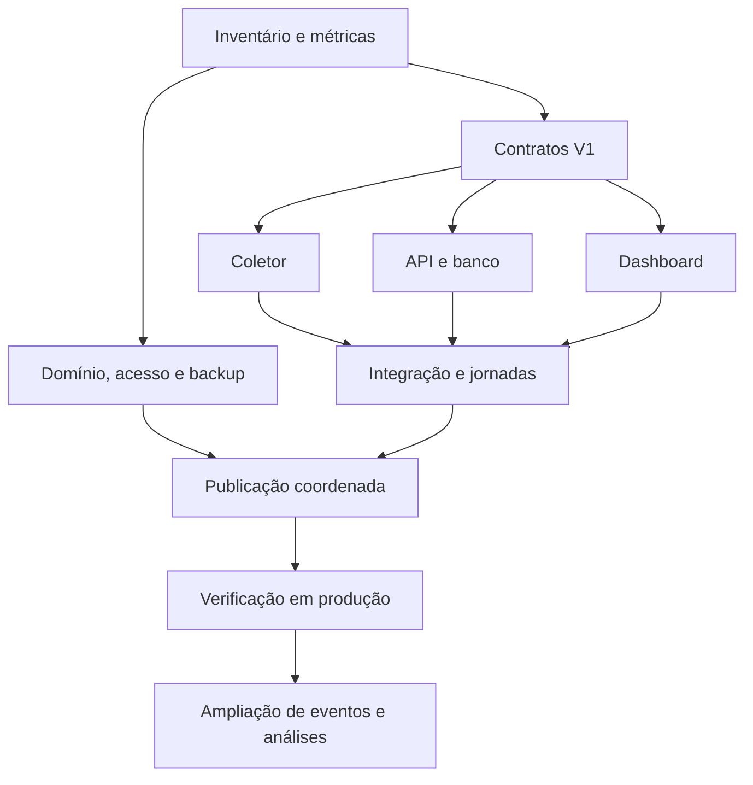

# 04 — Execução, validação e operação do dashboard

**Tipo:** plano de trabalho, sem implementação nesta entrega. **Data:** 12/10/2026, São Paulo. **Projeto:** Plante Uma Flor / `Zoriek1/LandingPage`. Leia a [visão geral](../plano-dashboard-tempo-real.md) e os documentos [01](01-coleta-eventos-e-metricas.md), [02](02-api-banco-seguranca-e-deploy.md) e [03](03-dashboard-produto-e-decisoes.md).

O objetivo é entregar dados próprios de uso e engajamento, com ações de contato como objetivo secundário. Coleta, métricas, banco e dashboard são independentes do GA4. A publicação desta etapa contém somente os cinco arquivos de planejamento, em commit com `[skip ci]`; todas as tarefas de implementação abaixo começam como pendentes.

## 1. Estratégia de entrega

Construir primeiro um fluxo completo de evento real até o painel, com autenticação e publicação verificadas. Ampliar a instrumentação e as telas depois de validar a qualidade dos primeiros dados. As estimativas não pressupõem migrar as landings para a VPS nem desenvolver um gravador de sessões.

| Marco | Resultado observável | Esforço adicional estimado | Total acumulado estimado |
| --- | --- | --- | --- |
| A — Versão inicial utilizável | Coleta das entradas públicas, API/banco, uma tela operacional, login, atualização e deploy | 16–24 h / 2–3 dias úteis | 2–3 dias |
| B — Comportamento e escolhas | Instrumentação detalhada, cinco telas, comparações e jornadas | 3–4 dias úteis | 5–7 dias |
| C — Operação ampliada | Diagnóstico, exportação, capacidade e validações operacionais adicionais | 2–5 dias úteis | 7–12 dias |
| D — Resultados externos e replay | Gestor, custos de mídia/receita ou replay, conforme módulo escolhido | Após contrato e acesso | Fora do total A–C |

Estimativas consideram infraestrutura disponível, tráfego moderado e um desenvolvedor usando componentes existentes. Trabalho paralelo pode diminuir o tempo decorrido, mas não elimina integração e validação. A prévia local pode surgir no primeiro dia; a entrega A só está concluída com dados reais, proteção de acesso e publicação funcionando. Esperas por credenciais, domínio ou configuração externa são separadas das horas estimadas.

## 2. Preparação: inventário que define o caminho crítico

Registrar respostas sem copiar senhas, tokens ou arquivos de credenciais para os documentos. Resolver o que afeta execução antes de provisionar qualquer serviço; o inventário não exige expor segredos em chat ou Git.

| Item | Resultado necessário | Efeito de ausência |
| --- | --- | --- |
| VPS | Sistema, CPU/RAM/disco, aplicações atuais, portas, permissões e rotina de manutenção conhecidos | Não dimensionar nem modificar serviços por suposição |
| Runtime | Docker/Compose ou caminho de execução Node definido e compatível | Preparar configuração; não reinstalar VPS existente |
| Domínio | Subdomínio da API, DNS, certificado e responsável pela renovação definidos | Bloqueia teste integrado HTTPS/deploy final |
| Deploy | Origem/branch, destino FTPS e mecanismo restrito de deploy da API identificados | Desenvolvimento local continua; publicação aguarda acesso |
| Banco | PostgreSQL dedicado ou banco existente adequado, persistência e backup definidos | Bloqueia ingestão persistente validada |
| Consentimento | Estado efetivo CookieHub/GTM e mecanismo de consulta/mudança conhecido | Coleta pública não inicia até integração correta |
| Administração | Administrador inicial, método de login e sessão definidos | API administrativa não pode ser exposta sem proteção |
| Volume | Sessões/mês, pico simultâneo e quantidade de administradores estimados | Limites permanecem provisórios; sem promessa de capacidade |
| Gestor | Contrato de resultados e correlação por token, somente fase D | Não bloqueia A–C; limita confirmação de conversas/vendas |

O repo confirma publicação estática por FTPS, mas não confirma os recursos da VPS ou as configurações do GTM. [Workflow auditado](https://github.com/Zoriek1/LandingPage/blob/2b2a937846e09e6603733fe7b725882503685d58/.github/workflows/deploy.yml), [configuração de entradas](https://github.com/Zoriek1/LandingPage/blob/2b2a937846e09e6603733fe7b725882503685d58/vite.config.ts).

## 3. Frentes de trabalho e dependências

| Frente | Pode fazer em paralelo | Depende de |
| --- | --- | --- |
| Contratos | Taxonomia, envelope, ACK, fórmulas e exemplos de referência | Definições de produto e auditoria do código |
| Coletor | Sessão/consentimento, sensores básicos, transporte e instrumentação | Contrato congelado para V1 e integração de CMP conhecida |
| Backend | Banco, ingestão, autenticação, queries e sinalização SSE | Contrato e esquema; acesso para validação na VPS |
| Dashboard | Layout, componentes, estados e consultas com fixtures identificadas | Modelo de resposta da API e fórmulas |
| Infra/entrega | Domínio, HTTPS, secrets, backup e pipeline | Inventário e artefatos reais; integração concluída para publicação |

Fixtures de desenvolvimento ficam claramente identificadas e fora das métricas de produção. O endpoint de ingestão não confia num booleano enviado pelo navegador para declarar um evento humano/autêntico; origin, rate limit e schema são controles de entrada, não prova de identidade.

Para reduzir prazo, reutilizar componentes, tokens, Recharts e lógica de atribuição existentes. Não criar um painel em outro repositório nem migrar toda a landing para habilitar o backend. Um processo Node e PostgreSQL atendem a arquitetura inicial; Redis, filas externas e bancos analíticos entram somente se medições justificarem.

## 4. Backlog implementável

Todos os itens abaixo estão **planejados**, não executados. Cada item tem saída verificável e dependência explícita. IDs servem para rastrear implementação futura, PRs e critérios de aceite; não representam issues já criadas no GitHub.

### 4.1. Marco A — primeira versão

| ID | Trabalho | Dependência | Entrega/aceite |
| --- | --- | --- | --- |
| A01 | Inventariar ambiente e atualizar diagnóstico do tracking atual | Acessos somente leitura | Registro dos recursos e divergências documentais; fluxo atual de WhatsApp confirmado |
| A02 | Consolidar contrato de eventos, ACK, sessão e métricas | A01, docs 01/02 | Exemplos válidos, nomes sem ambiguidade e lista de eventos A |
| A03 | Criar entrada Vite independente do dashboard | A02, regras do design system | Página administrativa não carrega trackers de marketing; landing não carrega gráficos do dashboard |
| A04 | Integrar estado de consentimento e ciclo de sessão no coletor | A02, CMP conhecida | Nenhuma nova coleta antes do aceite; revogação limpa a fila e interrompe os sensores |
| A05 | Instrumentar navegação, scroll/tempo, CTAs e variantes existentes | A04 | Cobertura das entradas públicas e contexto semântico, sem contar o mesmo clique duas vezes |
| A06 | Implementar transporte limitado, ACK e reenvio | A02, A04 | IDs estáveis nas tentativas; limitações de tamanho/TTL e deduplicação verificadas |
| A07 | Criar banco/migrações e ingestão transacional | A02, banco disponível | ACK após commit; apenas eventos novos alteram sessões/agregados |
| A08 | Implementar login/autorização administrativa | A02 | Sessão segura, validação de origem/CSRF e limites; dados inacessíveis sem autenticação |
| A09 | Criar overview, histórico e sinalização SSE | A07, A08 | Queries paginadas/limitadas; snapshot completo após reconexão |
| A10 | Montar tela operacional com estados reais | A03, A09 | Agora, rankings e resumo de engajamento, com filtros básicos e indicadores de frescor |
| A11 | Configurar HTTPS, persistência e backup básico | Inventário, A07/A08 | Dados sobrevivem a restart; backup e restauração básica verificados |
| A12 | Ampliar workflow com release coordenada | A06–A11 | Mesmo SHA, backend saudável antes do FTPS; recuperação de versão exercitada |
| A13 | Validar jornadas e comportamento em ambiente real | A12 | Evidência dos critérios de A; eventos de teste isolados das métricas reais |

Alocação preliminar de A: contrato/base 3–5 h; coleta/ingestão 5–7 h; painel 4–6 h; entrega/validação 4–6 h. Essa decomposição totaliza 16–24 h e não pressupõe que os módulos sejam independentes durante toda a execução.

### 4.2. Marco B — comportamento completo

| ID | Trabalho | Dependência | Entrega/aceite |
| --- | --- | --- | --- |
| B01 | Exposição de seções/produtos e interações de componentes | A validado | Sensores seguem limiares da doc 01 e respeitam visibilidade/consentimento |
| B02 | Medir filtros, FAQ, vitrine e seletor de preço | B01, componentes atuais | Abertura, escolha, fechamento e ação final têm significado distinto |
| B03 | Expandir queries e filtros | A09, B01/B02 | Períodos/dimensões coerentes, limites de cardinalidade e taxas com denominador |
| B04 | Implementar cinco telas e detalhes de sessão | B03, doc 03 | Navegação consistente, jornada paginada e classificação de origem clara |
| B05 | Funis, comparação e sinais de decisão | B03/B04 | Exposição/interação/contato separados, janela equivalente e volume visível |
| B06 | Validar todas as famílias de página e eventos | B01–B05 | Cobertura dos eventos B com evidência de uma jornada representativa por família |

Resultados externos não são simulados para preencher gráficos. A tela Ações e leads mostra cliques e estados efetivamente conhecidos; conversa, qualificação e receita aguardam a fase D.

### 4.3. Marco C — operação ampliada

| ID | Trabalho | Dependência | Entrega/aceite |
| --- | --- | --- | --- |
| C01 | Testar capacidade e otimizar consultas/agregação | Volume alvo, A/B | Throughput, p95 e pressão sobre o banco registrados |
| C02 | Diagnóstico de ingestão, atraso e conexão | A/B | Contadores de aceitos/rejeitados/duplicados e erros operacionais, sem payloads sensíveis |
| C03 | Exportação e requisitos adicionais de equipe | A08, requisitos reais | Exportação autorizada, limites e trilha de acesso definidos |
| C04 | Retenção, restauração e recuperação ampliadas | A11/A12 | Rotina documentada, tempo de recuperação medido e limpeza conforme política |
| C05 | Runbook e validação final | C01–C04 | Outro operador consegue identificar falha e recuperar o serviço usando o documento |

### 4.4. Marco D — módulos opcionais

| Módulo | Pré-requisito | Resultado |
| --- | --- | --- |
| Atendimento/Gestor | Contrato de webhook/API e correlação permitida | Conversa e qualificação confirmadas |
| Venda/receita | ID do pedido, estado de pagamento, tratamento de cancelamento/estorno | Receita e conversão de resultado reais |
| Gastos de anúncios | Contas autorizadas, período e moeda alinhados | CPL/CPA/ROAS com fonte e horário de atualização |
| Replay/heatmap | Finalidade, consentimento, máscara, retenção e ferramenta escolhida | Diagnóstico visual amostrado e separado da contagem de eventos |

Cada módulo tem orçamento, contrato e aceite próprios. Uma conta externa conectada não implica autorização para alterar anúncios ou enviar mensagens.

## 5. Plano de verificação por jornadas

Testar os resultados e cenários de falha, sem criar um teste espelhando cada linha de listener. Na implementação futura, usar Vitest onde apropriado, jornadas de navegador com Playwright e verificação do pipeline/banco. Esses testes não precisam ser executados para publicar somente os documentos deste plano.

| Cenário | Estímulo | Resultado esperado | Evidência |
| --- | --- | --- | --- |
| Consentimento inicial | Acessar com storage limpo, aguardar e interagir sem aceite | Novo coletor não envia eventos nem mantém fila comportamental | Rede/storage e consulta de eventos |
| Aceite tardio | Navegar e aceitar analytics depois | Coleta começa no estado atual; ações anteriores não são reconstruídas | Payloads e sequência da sessão |
| Revogação | Negar após fila ou sessão existente | Sensores/fila interrompidos; novos eventos não enviados | Rede/storage após alteração |
| Visita com campanha | Entrar com UTMs autorizadas e navegar | Campanha de entrada preservada; contexto atual da ação separado | Evento e visão de campanha |
| Campanha muda | Alterar UTM numa navegação posterior na mesma sessão | Origem passada não reescrita | Comparação das dimensões |
| SPA/prerender | Navegação interna, carga direta e hidratação | Uma visualização por apresentação elegível, sem duplicata de mount | IDs e contagem |
| Voltar/bfcache | Sair e voltar por histórico | Ciclo tratado conforme doc 01, sem duplicar listeners | Eventos e contadores |
| Aba oculta/inativa | Alternar de app/aba e aguardar | Tempo ativo pausa; presença expira conforme regra | Deltas, TTL e indicadores |
| Mais de uma aba | Abrir/duplicar aba e interagir | Identidade por aba conforme política; sem alegar pessoas únicas | IDs e sessões observadas |
| WhatsApp | Clicar, repetir e testar API indisponível | Interações registradas com IDs distintos; navegação continua | Rede, destino e contagens |
| Retry ambíguo | Servidor grava, resposta se perde e lote é reenviado | Um evento persistido; ACK informa duplicata | Restrição única e agregados |
| Lote parcialmente inválido | Enviar evento válido e evento com propriedade proibida | Resultado por evento segundo contrato, sem aceitar payload proibido | ACK e banco |
| Falha transacional | Simular erro de gravação antes do commit | Sem ACK de sucesso nem incremento parcial | Resposta e banco |
| SSE cai | Cortar/reabrir conexão enquanto dados chegam | Novo snapshot corrige visão; fallback mostra estado/atraso | UI e consultas |
| Usuário sem login | Consultar overview/events/stream/export | Nenhum dado privado retornado | HTTP e auditoria |
| Restart do serviço | Reiniciar aplicação/banco de forma controlada | Dados persistidos conservados | Consulta após restart |
| Painel vazio | Período sem eventos válidos | Estado vazio legítimo, sem dados de demonstração | UI |
| Dados atrasados | Reenvio de evento antigo dentro da política | Timestamp do evento e recebimento distintos; relatórios coerentes | Evento e janela do relatório |
| Deploy falha | Backend não fica saudável | Upload frontend dependente bloqueado; versão anterior recuperável | Logs sanitizados e versão |
| Dados sensíveis | Usar query, texto ou campo de teste que não pertence à allowlist | Conteúdo excluído antes do envio e rejeitado se aparecer na API | Payload/banco de teste |

Cobrir home, uma LP genérica, LP com variante, entradas Dia das Mães/Namorados e loja física; depois repetir eventos específicos nas configurações que realmente os renderizam. Não usar componentes legados fora dos entry points como comprovação de cobertura de produção.

## 6. Performance, carga e observabilidade

Os limites seguintes são hipóteses iniciais. Registrar hardware, dados, consultas e número de clientes do teste; não declarar capacidade com base em um número sem contexto.

| Medida | Meta ou regra inicial | Como verificar |
| --- | --- | --- |
| Frescor de atualização | Usual 2–5 s; p95 persistência → painel até 5 s em operação normal | Evento controlado, timestamp de commit e medição de renderização |
| Latência total | Medida separadamente desde a ação do navegador | Clock monotônico/local e correlação com recebimento, considerando diferenças de relógio |
| Coleta | Flush 2 s, 50 eventos/32 KiB por lote, 4 KiB por evento | Payloads reais e carga sintética limitada |
| Retentativa | Máximo 5 tentativas, TTL 10 min, fila 100 eventos/128 KiB | Offline, 429, 5xx e consentimento revogado |
| Presença | Atualização visível 15 s, expiração 60 s | Aba oculta, retorno e timers reduzidos no navegador |
| Landing | Sem bundle administrativo e sem bloqueio de CTA | Inspeção de build/rede e comparação com baseline |
| Banco | Índices e agregados sustentam período/filtros acordados | Plano de consulta e p95 com volume representativo |

A medição de latência do usuário pode ser influenciada por relógio, rede e suspensão do navegador. A meta não cobre um evento que nunca chegou. Observabilidade começa com eventos aceitos, rejeitados e duplicados, latência da API, erros de consulta, conexões SSE e estado de backup; ampliar detalhes de diagnóstico na fase C.

Proposta de alertas iniciais: ingestão 5xx acima do baseline por janela definida; atraso persistência→painel acima da meta; backup falhando; pouco disco disponível; rate limit rejeitando tráfego legítimo. Calibrar limites depois do piloto. Sem tráfego, ausência de eventos sozinha não caracteriza indisponibilidade: usar health check e teste sintético separado.

## 7. Release, recuperação e critérios para publicar

O workflow atual envia `dist/` por FTPS em push na `main`. A implementação futura acrescenta backend/migrações e health check antes do upload frontend; ver detalhes na [doc 02](02-api-banco-seguranca-e-deploy.md). Banco e volumes não ficam dentro do diretório de deploy da landing.

Checklist de uma release de implementação:

- [ ] Artefatos frontend/backend e versão de schema identificam o mesmo commit.
- [ ] Migração compatível não impede o coletor anterior durante a transição.
- [ ] API responde com versão correta e banco saudável antes da publicação frontend.
- [ ] Assets anteriores necessários permanecem disponíveis durante a transição.
- [ ] Login, coleta consentida, snapshot e reconexão passam no ambiente de destino.
- [ ] Tráfego sintético fica separado de tráfego real.
- [ ] Backup e caminho de recuperação foram verificados.
- [ ] Responsável e procedimento de rollback são conhecidos.

Se a API falhar antes do upload, manter frontend anterior; se o frontend novo falhar, restaurar o artefato anterior compatível. Migrações destrutivas não são revertidas cegamente junto do container. Documentar recuperação por compatibilidade e, quando necessário, restauração controlada de banco. Publicação entre dois destinos não é transação atômica.

## 8. Runbook planejado

| Sintoma | Verificar primeiro | Ação planejada |
| --- | --- | --- |
| Painel não atualiza | Sessão administrativa, conexão SSE, última atualização, overview | Reconectar/refazer snapshot e identificar API ou cliente |
| Poucos eventos | Tráfego real, consentimento, erros/rejeições, versão dos entry points | Comparar jornada controlada e versões; não concluir perda absoluta |
| Muitas duplicatas | ACK perdido, retry, duplicação de listeners | Conferir IDs e idempotência; corrigir origem da repetição |
| Cliques diferem do Gestor/Meta | Supressão de 4 h, finalidade e regra de conversão de cada destino | Explicar métricas distintas; não somar fontes diferentes |
| Banco lento | Índices, período consultado, cardinalidade, pool e agregados | Limitar consultas e otimizar com evidência |
| API com 5xx | Saúde do banco, conexão, recursos, release recente | Recuperar versão compatível e investigar falha transacional |
| Backup falhou | Último sucesso, armazenamento, acesso e retenção | Restaurar rotina e validar backup utilizável |
| DNS/TLS falhou | Resolução, certificado, proxy e renovação | Corrigir conectividade; manter landing navegável |

Não registrar segredos ou payloads completos em logs para facilitar o diagnóstico. Admin exporta apenas dados autorizados; a operação de ingestão pública permanece sem acesso de leitura ao banco.

## 9. Riscos, decisões e limites

| Risco/pendência | Efeito | Tratamento planejado |
| --- | --- | --- |
| Documentação descreve modal que não existe | Instrumentação incorreta ou contagem inventada | Código auditado prevalece; alinhar documentação antes de alterar CTAs |
| Backend/contêiner de terceiros não auditado | Confirmação de lead/venda incerta | Exibir somente estados conhecidos; integração explícita na fase D |
| CMP instalada via GTM | Ordem/estado de consentimento pode não cobrir SDK próprio | Integração explícita e teste com storage limpo |
| JS/rede/bloqueadores | Cobertura observada parcial | Fila limitada, ACK/dedup e comunicação clara de cobertura |
| Logs/captura de URL livre | Dados pessoais ou tokens podem vazar | IDs semânticos e allowlist desde navegador até API |
| Muitas dimensões/heartbeat | Volume/custo e queries aumentam | Limitar parâmetros, métricas agregadas e medir uso real |
| Publicação em dois destinos | Versões coexistem temporariamente | Contratos compatíveis, health check e artefatos para recuperação |
| Pouca amostra ou tráfego diferente | Decisões falsas de marketing | Volume/denominador visíveis e testes com distribuição definida |
| VPS compartilhada com serviços atuais | Mudança pode causar disputa de recursos | Inventário e limites antes de acrescentar containers |
| Recurso extra aumenta escopo | Prazo deixa de refletir A–C | Estimar separadamente replay, Ads e resultados do Gestor |

## 10. Publicação somente destes documentos

Esta entrega autoriza somente arquivos Markdown de plano. Mensagem proposta: `docs: detalha plano do dashboard de marketing [skip ci]`. Não editar o workflow para suprimir CI: a instrução fica no commit. GitHub reconhece `[skip ci]` para workflows disparados por `push` e `pull_request`; ela não se aplica a todo evento possível. O repo auditado tem um workflow de deploy por push, portanto o marcador corresponde ao pedido desta etapa. [GitHub: skipping workflow runs](https://docs.github.com/en/actions/how-tos/manage-workflow-runs/skip-workflow-runs).

Verificação da entrega documental:

- [ ] Todos os links relativos entre os cinco documentos resolvem.
- [ ] Envelope, limites, sessão, consentimento e nomes de métricas são consistentes.
- [ ] Propostas são distinguidas de fatos do código e fontes oficiais.
- [ ] O diff contém somente os cinco arquivos Markdown de plano.
- [ ] Commit na `main` contém `[skip ci]`.
- [ ] SHA remoto confirma a publicação e os arquivos são acessíveis no GitHub.
- [ ] Verificar se existe execução de workflow associada ao commit; documentar resultado observado.

Nesta etapa não há instalação de dependências, alteração de código da aplicação, edição de tags, configuração da VPS ou deploy do dashboard.
