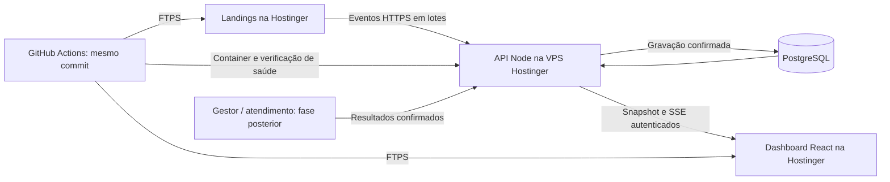

# Plano de dashboard de comportamento e marketing em tempo real

Pesquisa e planejamento em **12/10/2026**, horário de São Paulo. Nenhuma implementação, instalação, alteração de configuração ou publicação faz parte desta etapa.

Projeto: [Zoriek1/LandingPage](https://github.com/Zoriek1/LandingPage). Código auditado: `2b2a937846e09e6603733fe7b725882503685d58`. Prioridade informada: **uso e engajamento das páginas**, com **leads como objetivo secundário**. A resposta sobre hospedagem foi interpretada como disponibilidade de Node.js e VPS na Hostinger; plano exato e recursos ainda não foram inspecionados no hPanel.

Revisão do plano: o usuário pediu uma entrega mais rápida e um plano completo por fases. **Primeira versão utilizável: 2–3 dias úteis estimados (16–24 horas de trabalho), com infraestrutura e acessos disponíveis. Plano completo de comportamento: 7–12 dias úteis acumulados, incluindo a primeira entrega.** Integrações de venda, gasto de anúncios e replay têm escopo posterior. Essas estimativas representam esforço de desenvolvimento e validação; não são compromisso de prazo corrido nem autorização para iniciar implementação.

## Índice da especificação completa

Esta visão geral é acompanhada por quatro documentos de planejamento. Exemplos JSON, nomes de endpoints, estruturas de banco, parâmetros de capacidade e tarefas são especificações propostas para uma implementação futura; não representam funcionalidades já instaladas.

| Documento | Conteúdo e responsabilidade |
| --- | --- |
| [01 — Coleta, eventos e métricas](dashboard-tempo-real/01-coleta-eventos-e-metricas.md) | Contrato V1, instrumentação das entradas e componentes, sessão, consentimento, reenvio, atribuição e fórmulas |
| [02 — API, banco, segurança e deploy](dashboard-tempo-real/02-api-banco-seguranca-e-deploy.md) | Ingestão/ACK, persistência, agregação, autenticação, snapshots/SSE, VPS, backups, publicação e recuperação |
| [03 — Dashboard, produto e decisões](dashboard-tempo-real/03-dashboard-produto-e-decisoes.md) | Telas, blocos, filtros, estados, jornadas, decisões de marketing, acessibilidade e aceite de produto |
| [04 — Execução, validação e operação](dashboard-tempo-real/04-execucao-validacao-e-operacao.md) | Marcos, backlog, dependências, trabalho em paralelo, testes de jornadas, riscos e critérios de conclusão |

Ordem sugerida de leitura: esta visão geral → 03 para compreender o produto → 01 e 02 para implementar → 04 para organizar e verificar as entregas. Em caso de ambiguidade, 01 define eventos e métricas; 02 define transporte/API e persistência; 03 define apresentação; 04 define escopo dos marcos. Uma mudança de contrato deve atualizar todos os documentos afetados na mesma revisão.

Decisões consolidadas para a V1: endpoint `POST /collect`; `schema_version: 1`; máximo inicial de 50 eventos/32 KiB por lote e 4 KiB por evento; envio a cada 2 segundos; presença a cada 15 segundos com expiração de 60 segundos; tempo ativo com janela de interação recente de 30 segundos; sessão renovada após 30 minutos sem atividade elegível, sem renovação por heartbeat; coleção comportamental sem IDs de GA4 nem identificadores brutos de publicidade. Limites são pontos de partida sujeitos a medição e descritos em detalhe nos documentos 01 e 02.

## 1. Recomendação

Adicionar um dashboard próprio ao mesmo repositório e à mesma execução de deploy do site. Manter as landings estáticas na hospedagem atual; colocar somente a API de eventos e o banco na VPS Hostinger. Assim aproveitamos a infraestrutura existente e temos controle sobre o conteúdo, a persistência e o atraso dos dados.

O usuário esclareceu que prefere uma experiência simples e independente do GA4. **A coleta própria será a única fonte do dashboard.** GA4 aparece nesta pesquisa apenas como comparação e possível integração futura; não é requisito, banco ou origem das métricas do MVP.

Um middleware de servidor vê requisições HTTP, mas ações como scroll, abertura de FAQ e mudanças de filtros acontecem no navegador. A solução precisa de duas partes: coletor JavaScript que observa essas interações e API que recebe, valida e persiste os eventos. Isso permite uma interface de marketing mais simples de usar; desenvolver e operar essa infraestrutura exige mais trabalho do que instalar uma ferramenta pronta. Hospedar a coleta por conta própria dá controle e observabilidade, mas não garante captura absoluta de cada ação.

Stack proposta para o MVP:

- **Dashboard:** React + TypeScript, componentes e tokens do projeto, gráficos com Recharts já disponível; entrada Vite própria.
- **Coleta:** módulo pequeno de eventos explícitos nas páginas, assíncrono, integrado aos pontos de interação existentes.
- **Backend:** Node.js com framework mantido, por exemplo Fastify, em container na VPS.
- **Banco:** PostgreSQL persistente na VPS; aproveitar banco existente se o inventário mostrar uma opção adequada. Sem Redis ou fila externa no MVP.
- **Atualização:** SSE, fluxo unidirecional do servidor para o dashboard, com fallback de consultas HTTPS a cada 5 segundos.
- **Publicação:** uma release do mesmo commit no GitHub Actions, com verificação do backend antes de publicar frontend por FTPS.

Essas escolhas são recomendações de engenharia, não exigências dos fornecedores. A Hostinger documenta Docker/Compose e volumes na VPS. Sua documentação de conectividade indica WebSocket de saída em Web/Cloud e VPS para conexões de entrada. Node.js disponível no plano não basta para presumir suporte a todo protocolo de conexão. [Docker Manager](https://www.hostinger.com/support/12040789-hostinger-docker-manager-for-vps-simplify-your-container-deployments/), [conectividade Hostinger](https://www.hostinger.com/support/which-web-standards-and-connectivity-features-are-supported-at-hostinger/).

SSE atende um painel que apenas recebe novidades; WebSocket pode ser considerado se surgir necessidade de comunicação bidirecional. SSE oferece reconexão no navegador, mas a API ainda precisa implementar recuperação dos dados perdidos. [MDN: SSE](https://developer.mozilla.org/en-US/docs/Web/API/Server-sent_events/Using_server-sent_events).

URL proposta do painel: `https://lpb.planteumaflor.com/admin/marketing/`. A API usaria um subdomínio HTTPS do mesmo domínio principal, a definir. Esses endereços são propostas; nada foi provisionado. O código e a release ficam juntos, embora frontend e API tenham runtimes separados. Hospedar tudo na mesma máquina também é possível com uma migração completa para a VPS, que não é necessária para atender ao objetivo inicial.

## 2. O que o projeto já possui

O workflow atual executa testes, lint e build e publica **somente `dist/` por FTPS** quando há push na `main`. Não contém backend de analytics, banco ou autenticação. [Workflow auditado](https://github.com/Zoriek1/LandingPage/blob/2b2a937846e09e6603733fe7b725882503685d58/.github/workflows/deploy.yml#L1).

Já há uma base de atribuição: UTMs, identificadores de anúncios, origem da sessão por aba, `event_id` e `token_rastreio` do WhatsApp. Há eventos de visita inicial, WhatsApp, saída para catálogo, variante de oferta, ligação e rota da loja física. Os destinos diferem entre GTM, Meta e API de leads. [Tracking](https://github.com/Zoriek1/LandingPage/blob/2b2a937846e09e6603733fe7b725882503685d58/src/lib/tracking.ts#L20), [atribuição](https://github.com/Zoriek1/LandingPage/blob/2b2a937846e09e6603733fe7b725882503685d58/src/lib/attribution.ts#L37).

Pontos que afetam diretamente o plano:

1. **Documentação divergente:** `docs/tracking.md` descreve modal de telefone e Meta Lead; no código auditado o helper abre o WhatsApp diretamente, após tentar o tracking, e emite Meta Contact. A primeira etapa deve atualizar essa documentação. [Fluxo atual](https://github.com/Zoriek1/LandingPage/blob/2b2a937846e09e6603733fe7b725882503685d58/src/lib/whatsappModal.ts#L178), [Contact atual](https://github.com/Zoriek1/LandingPage/blob/2b2a937846e09e6603733fe7b725882503685d58/src/lib/tracking.ts#L254).
2. **Contagens têm regras diferentes:** todo clique WhatsApp vai ao `dataLayer`, mas Contact e API de leads têm deduplicação por 4 horas/campanha. O dashboard de comportamento precisa medir cada interação, sem herdar essa supressão de conversões. [Regra atual](https://github.com/Zoriek1/LandingPage/blob/2b2a937846e09e6603733fe7b725882503685d58/src/lib/tracking.ts#L234).
3. **Confirmação limitada:** a resposta HTTP da API atual não demonstra conversa recebida, qualificação ou compra. Fetch e beacon podem entregar o mesmo payload, justificando idempotência pelo `event_id`. [Envio atual](https://github.com/Zoriek1/LandingPage/blob/2b2a937846e09e6603733fe7b725882503685d58/src/lib/tracking.ts#L183).
4. **Múltiplas entradas:** home, LPs prerenderizadas, campanhas e `/loja-fisica/` devem receber a nova coleta. Instrumentar apenas `App.tsx` deixaria entradas descobertas. [Configuração Vite](https://github.com/Zoriek1/LandingPage/blob/2b2a937846e09e6603733fe7b725882503685d58/vite.config.ts#L379).
5. **Dashboard com entrada própria:** o HTML da landing inicializa trackers de marketing. Uma entrada separada evita rastrear administradores e carregar código do painel nas páginas públicas. [HTML atual](https://github.com/Zoriek1/LandingPage/blob/2b2a937846e09e6603733fe7b725882503685d58/index.html#L29).

A auditoria não acessou o contêiner GTM/CookieHub, o backend do Gestor, a VPS nem o hPanel. As versões efetivas do projeto vêm de `package.json` e lockfile; README/AGENTS ainda citam versões antigas de Vite e Router. [Dependências atuais](https://github.com/Zoriek1/LandingPage/blob/2b2a937846e09e6603733fe7b725882503685d58/package.json).

## 3. O que medir

“Tudo que a pessoa faz” será traduzido em uma jornada de interações relevantes e, opcionalmente, replay mascarado. Eventos explícitos tornam possível comparar páginas e campanhas mesmo quando texto, CSS ou layout mudarem.

| Grupo | Eventos propostos | Pergunta respondida |
| --- | --- | --- |
| Navegação | `page_view`, mudança de rota, entrada e saída para destino classificado | Onde entrou e por onde passou? |
| Exposição | `section_view`, `product_view`, `cta_view`, `control_view` e marcos de scroll | O conteúdo ou controle chegou a aparecer na tela? |
| Exploração | filtro, expansão da vitrine, FAQ, carrossel manual e ação relacionada ao produto | O que despertou interesse ou dúvida? |
| Escolhas | abertura do seletor, faixa escolhida, fechamento, variante vista | Que oferta/preço a sessão explorou? |
| Ações | CTA, WhatsApp, catálogo, ligação, rota | Que ação ocorreu e em qual posição? |
| Tempo | segundos visíveis, tempo ativo estimado, heartbeat | Qual uso está acontecendo agora? |
| Fricção | erro saneado, clique repetido ou sem efeito como heurística | Onde investigar problemas? |
| Resultado | registro confirmado, conversa, qualificação, pedido pago | Qual resultado foi comprovado pelo servidor? |

Incluir IDs estáveis de página, produto, seção, CTA e opção; separar ação manual de carrossel automático. Capturar os eventos de escolhas nos componentes que já controlam o estado. Para cliques gerais, utilizar elementos autorizados e IDs semânticos; o feed principal usa o contrato acima.

Critérios iniciais, a validar:

- Exposição: elemento visível por pelo menos 1 segundo; limiar ajustado ao tamanho da seção/produto. Visibilidade no viewport indica exposição, não leitura comprovada. [MDN: exposição](https://developer.mozilla.org/en-US/docs/Web/API/Intersection_Observer_API/Timing_element_visibility).
- Sessão: identificador pseudônimo por aba, renovado após 30 minutos de inatividade; `pageview_id` para cada navegação. Contar sessões, sem apresentar esse número como pessoas únicas entre dispositivos.
- Presença: heartbeat limitado a cada 15 segundos enquanto a página estiver visível; sessão online expira após 60 segundos sem atualização. Definição exibida no painel.
- Tempo ativo estimado: acumular com página visível e interação elegível nos últimos 30 segundos, pausando por inatividade. Heartbeat não renova a sessão de 30 minutos. Separar de tempo meramente aberto. [MDN: Page Visibility](https://developer.mozilla.org/en-US/docs/Web/API/Page_Visibility_API).
- Exploração: sessões com ação relevante observada, como produto, filtro, FAQ ou CTA, conforme eventos instrumentados em cada fase. Tempo ativo e scroll são indicadores separados; a V1 não depende de uma pontuação composta ou definição importada do GA4.
- Funil secundário: página → vitrine/produto → clique WhatsApp → resultado confirmado. Calcular por sessões elegíveis e apresentar contagens junto às taxas.

As definições acima são decisões propostas, não defaults de ferramentas. “Abandono” só será estimado após inatividade; a ausência de um evento de saída não comprova que o usuário saiu. Conteúdo em iframe externo requer cooperação do embed; saída para WhatsApp ou catálogo encerra a observação deste site até existir integração do outro lado. [MDN: iframe](https://developer.mozilla.org/en-US/docs/Web/HTML/Reference/Elements/iframe).

## 4. Telas e decisões de marketing

| Tela | Conteúdo | Decisão apoiada |
| --- | --- | --- |
| Agora | sessões online/ativas, páginas atuais, eventos recentes, último recebimento e conexão | A campanha está trazendo uso? Há falha de coleta? |
| Engajamento | exposição por seção, scroll, tempo ativo e exploração por dispositivo | Que conteúdo deve mudar de posição ou clareza? |
| Produtos e escolhas | produto exposto → CTA relacionado, filtros, faixas e variantes | Que ofertas merecem destaque ou teste? |
| Páginas e campanhas | LP, UTM, criativo informado, origem e dispositivo; hoje/7/30 dias | Onde há interesse ou fricção consistente? |
| Leads | clique, estado de registro e resultados comprovados | Em que etapa a intenção perde continuidade? |

Permitir filtrar por período, LP, campanha, variante, produto, dispositivo e posição do CTA. Mostrar volume, denominador e cobertura observada. Comparações usam janelas equivalentes; uma campanha com poucos acessos recebe indicação de dados insuficientes.

Exemplos de investigação: muitas exposições e poucos CTAs relacionados a um produto; muita exploração de filtros/FAQ e pouco WhatsApp; FAQ de frete muito acessada antes de saída; queda de exposição da vitrine no mobile. O código atual não tem uma etapa independente de abertura/detalhe de produto; sua trajetória observável é exposição e CTA relacionado. São sinais para formular testes, não causas comprovadas. Recomendações iniciais podem ser regras transparentes. Testes de variantes precisam registrar exposição e forma de distribuição; diferenças observacionais não provam causalidade. O log CRO existente já pede hipóteses e volume de medição. [Convenção CRO](https://github.com/Zoriek1/LandingPage/blob/2b2a937846e09e6603733fe7b725882503685d58/docs/cro/medicoes.md).

CPL, CPA e ROAS entram somente com gasto de mídia, resultado qualificado e receita confirmada. A janela de atualização dessas fontes aparecerá separadamente da atividade ao vivo. Mudanças de oferta e orçamento ficam como decisões humanas nesta proposta.

## 5. Contrato, entrega e tempo real

Envelope mínimo proposto: `event_id`, `schema_version`, `event_type`, `occurred_at`, `session_id`, `tab_id`, `pageview_id`, path canônico, dimensões autorizadas, estado/versão de consentimento e `release_sha`. O servidor acrescenta `received_at` e estado de persistência. Armazenar timestamps em UTC e exibir São Paulo.

Reutilizar o ID do clique já enviado aos destinos atuais quando ele representar a mesma ação; eventos novos usam UUID. Criar restrição única no banco e reutilizar IDs em tentativas de reenvio. Isso elimina duplicação de transporte, sem eliminar cliques distintos. O contrato de conversão existente conserva sua própria regra de negócio.

Fluxo proposto:

1. Coletor envia lotes pequenos a cada 2 segundos, com flush de saída quando aplicável. Analytics não acrescenta espera ao CTA nem impede navegação em caso de indisponibilidade.
2. API valida nomes, propriedades, tamanho, horários e limites de envio; confirma somente após gravar.
3. Banco mantém eventos e projeções de sessões/agregados por minuto. MVP usa um processo de aplicação, sem memória como única fonte dos dados.
4. Dashboard recebe snapshot autenticado. SSE sinaliza alterações somente depois da persistência; o painel recarrega snapshots e a janela de eventos recentes com agrupamento curto das atualizações. Recarregar também ao conectar/reconectar e periodicamente evita depender de deltas perdidos. Histórico fica consultável no banco. Um stream completo de eventos com cursor/replay só entra se for necessário.
5. Página oculta tenta flush com `sendBeacon` ou `fetch` keepalive. Beacon confirma enfileiramento no navegador, não recebimento no servidor; lotes e tentativas têm limite. [MDN: sendBeacon](https://developer.mozilla.org/en-US/docs/Web/API/Navigator/sendBeacon).

**Meta de produto:** atualização usual em 2–5 segundos e objetivo técnico p95 de até 5 segundos entre persistência e exibição, a medir em staging com carga representativa. Esses valores são metas propostas, não SLA já existente. Medir também a latência total desde a ação, que inclui lote e rede do visitante.

Painel mostra estado da conexão, última atualização e atraso, inclusive quando cair para polling. Reconexão carrega um novo snapshot; consultas históricas recuperam jornadas fora da janela recente. Eventos fora de ordem e atraso de rede são tratados pelo servidor; o relógio do visitante não define sozinho os resultados.

Uma coleta no navegador oferece cobertura parcial: consentimento, bloqueadores, JavaScript e rede influenciam os dados. IDs pseudônimos não significam anonimização. Não apresentar o painel como registro de 100% de pessoas/ações. A coleta não contorna a escolha de recusa do visitante.

## 6. Acesso, consentimento e retenção

Proposta para a nova coleta comportamental: iniciar após consentimento analítico válido, integrado ao CookieHub; publicidade e replay têm finalidades explicitadas. Verificar estado inicial, aceite posterior, recusa e revogação. O código atual não demonstra esse bloqueio para todos os envios diretos; a configuração operacional da CMP precisa ser verificada antes de ampliar o tracking. [Código auditado](https://github.com/Zoriek1/LandingPage/blob/2b2a937846e09e6603733fe7b725882503685d58/src/lib/tracking.ts#L32).

A ANPD recomenda transparência, finalidades definidas e controle do titular; trata consentimento e legítimo interesse como hipóteses possíveis, conforme o contexto. Para este projeto, consentimento é a proposta de base da coleta comportamental detalhada. A política deve permitir recusa/revogação e definir retenção. A LGPD exige necessidade e adequação e prevê direitos de acesso e eliminação. [Guia ANPD, seções de hipóteses legais e banners](https://www.gov.br/anpd/pt-br/centrais-de-conteudo/materiais-educativos-e-publicacoes/guia-orientativo-cookies-e-protecao-de-dados-pessoais.pdf/@@display-file/file), [LGPD, arts. 6, 7, 8, 18](https://www.planalto.gov.br/ccivil_03/_ato2015-2018/2018/lei/l13709compilado.htm).

Desenho proposto dos dados: path e domínio de origem, parâmetros de campanha/variante autorizados e IDs de catálogo; conteúdos de mensagens, formulários, telefone, coordenadas e querystrings arbitrárias ficam fora do payload comportamental. `token_rastreio`, quando usado para integração de atendimento, recebe acesso e finalidade próprios. Replay começa com máscara estrita, amostragem e revisão de uma gravação de teste.

Autenticação e autorização na **API**, incluindo consultas, exportação e stream. Uma rota escondida ou um guard React não protege dados. Cookie de sessão seguro, HttpOnly e restrito ao host e prefixo administrativo da API; frontend e API em subdomínios requerem credenciais e CORS com origem exata, além de proteção CSRF/validação de origem para operações de sessão. EventSource nativo usa a opção de credenciais, sem configuração de header Authorization; projetar autenticação compatível. [MDN: CORS](https://developer.mozilla.org/en-US/docs/Web/HTTP/Guides/CORS), [EventSource](https://developer.mozilla.org/en-US/docs/Web/API/EventSource/EventSource). O endpoint público de ingestão tem limite de taxa e validação de schema; chave embutida no navegador não é segredo nem prova de legitimidade do evento.

Retenção inicial para avaliação: eventos detalhados por 90 dias; agregados sem identificadores individuais por 12 meses. Prazo depende da finalidade e da política aprovada antes da operação. Limpeza agendada, backups persistentes e restauração verificada entram no trabalho da VPS. Explicar que backups têm expiração própria. Definir controle de acesso administrativo e procedimento de exportação/eliminação.

## 7. Alternativas pesquisadas

| Opção | Vantagem | Limitação para este objetivo |
| --- | --- | --- |
| Coletor próprio + VPS | Controle da jornada, dos dados e do atraso; acompanha o projeto/deploy | Requer manutenção de API, banco, acesso e backups |
| PostHog Cloud | Eventos, funis, autocapture e replay prontos | Painel integrado exige API/Endpoints, avaliação de quotas/frescor e dados em serviço externo |
| Umami self-host | Analytics pronto; v3 possui opção de replay | Runtime Node/PostgreSQL separado; integração do painel próprio ainda precisa de trabalho |
| Matomo on-premise | Analytics pronto em PHP/MySQL, Live API | Stack/arquivamento próprios; interface customizada exige integração |
| GA4 | Aquisição e atribuição consolidadas; já relacionado ao GTM | Realtime agregado tem schema limitado e frescor sem nossa meta de segundos |
| Clarity | Heatmaps e replay, inclusive live no portal | API de exportação agrega dados e permite apenas dez chamadas/dia |

Fontes e distinções relevantes:

- PostHog permite restringir autocapture por elemento, evento e URL. APIs normais de analytics têm 1.200 chamadas/hora por organização; Query API tem 2.400/hora. Endpoints é uma opção específica para dashboards, com cache/materialização, cuja quota e frescor precisariam ser validados. Seu Live Events lê antes da ingestão; evento visível ali pode depois ser descartado. [Autocapture](https://posthog.com/docs/product-analytics/autocapture), [API](https://posthog.com/docs/api), [Endpoints](https://posthog.com/docs/endpoints), [ingestion warnings](https://posthog.com/docs/data/ingestion-warnings).
- Umami self-host exige Node e PostgreSQL. Replay está documentado na v3.1; comparações antigas que o descrevem como sem replay estão desatualizadas. [Instalação](https://docs.umami.is/docs/install), [replay](https://docs.umami.is/docs/replays).
- Matomo requer PHP e MySQL/MariaDB. A Live API pode fornecer visitas/ações; relatórios agregados em escala dependem de arquivamento configurado. [Requisitos](https://matomo.org/docs/requirements/requirements/), [Reporting API](https://developer.matomo.org/guides/reporting-api), [performance](https://matomo.org/faq/on-premise/how-to-configure-matomo-for-speed/).
- GA4 Realtime cobre uma janela de 30 minutos no Standard e disponibiliza somente parte das dimensões/métricas. A documentação de frescor descreve processamento típico em poucos minutos; um refresh de tela a cada 5 segundos não altera essa latência. [Schema](https://developers.google.com/analytics/devguides/reporting/data/v1/realtime-api-schema), [frescor](https://support.google.com/analytics/answer/11198161?hl=en).
- Clarity tem replay live no portal; sua Data Export API permite dez chamadas/dia e dados agregados de 24/48/72 horas. Portanto não será a fonte do feed de ações do projeto. [Live](https://learn.microsoft.com/en-us/clarity/session-recordings/clarity-real-time), [Export API](https://learn.microsoft.com/en-us/clarity/setup-and-installation/clarity-data-export-api).

**Escolha para este projeto:** coleta própria como única fonte do painel operacional; replay/heatmap como complemento opcional. UTMs, jornadas, sessões e métricas são calculadas no sistema próprio, independentemente do GA4. Integrações publicitárias existentes são um fluxo separado e sua revisão será escopo específico de uma implementação futura. Isso combina personalização no projeto com autonomia sobre dados/latência. PostHog ou Umami são alternativas válidas se a prioridade mudar para reduzir desenvolvimento e aceitar a estrutura pronta desses produtos.

Custos de referência, verificados nesta pesquisa e sujeitos a mudança: PostHog Cloud oferece 1 milhão de eventos e 5 mil gravações/mês na faixa grátis; Umami Cloud oferece Hobby de 100 mil eventos grátis, Pro US$20/mês e Business US$200/mês, sendo streaming/replay recursos do Business na oferta consultada; Clarity é gratuito. [PostHog preços](https://posthog.com/pricing), [Umami preços](https://umami.is/pricing), [Clarity FAQ](https://learn.microsoft.com/en-us/clarity/faq). São opções comparadas, não serviços contratados ou recomendação de compra.

Se replay for escolhido, avaliar uma ferramenta mantida antes de construir um gravador próprio. PostHog mascara inputs por padrão, mas texto geral exige configuração; carregar e testar máscaras antes da primeira gravação. Serviços Cloud colocam esses dados fora da Hostinger e precisam ser avaliados sob esse requisito. [Privacidade de replay](https://posthog.com/docs/session-replay/privacy).

## 8. Deploy junto do projeto

Estrutura proposta, apenas para implementação futura:

- `src/analytics/`: contrato, consentimento, sessão e transporte.
- `src/dashboard/` e entrada HTML dedicada: telas administrativas.
- `server/analytics/`: ingestão, sessões administrativas, consultas e SSE.
- `infra/analytics/`: Compose, proxy HTTPS e migrações.
- `.github/workflows/deploy.yml`: validação e publicação coordenada do mesmo commit.

Contrato inicial da API, apenas proposta de organização:

| Endpoint | Função | Acesso |
| --- | --- | --- |
| `POST /collect` | Receber lotes, validar e confirmar IDs persistidos | Público, com limites e schema |
| `POST /admin/login`, `POST /admin/logout` | Criar/encerrar sessão administrativa | Protegido contra abuso e CSRF conforme operação |
| `GET /admin/overview` | Totais, sessões ativas e rankings | Administrador autenticado |
| `GET /admin/events` | Janela recente e histórico paginado | Administrador autenticado |
| `GET /admin/stream` | SSE de sinalização de atualização | Administrador autenticado |
| `GET /health` | Estado técnico para deploy, sem segredos | Resposta mínima |

Modelo inicial do banco:

- `events`: eventos persistidos e propriedades autorizadas; unicidade por projeto/ID, índices de período e sessão.
- `sessions`: primeira/última atividade, página recente e dimensões permitidas.
- `minute_metrics`: agregados para consultas do painel sem reler todo o histórico.
- Usuários e sessões administrativas: estrutura da biblioteca de autenticação selecionada.

Na versão rápida há um administrador; gestão de permissões de equipe fica para necessidade demonstrada. Banco, migrações e configurações de autenticação ficam fora do bundle público.

Pipeline proposto:

1. Validar dependências, types, lint, testes de jornadas e build; gerar artefatos frontend/backend do mesmo SHA.
2. Publicar imagem backend imutável e aplicar migração compatível com a versão anterior.
3. Atualizar API na VPS e aguardar saúde, conectividade com banco e confirmação do SHA servido.
4. Publicar landing/dashboard por FTPS mantendo o workflow existente; enviar assets antes dos HTMLs que os referenciam e conservar chunks antigos necessários durante a transição. Validar o comportamento da Action escolhida antes de presumir ordenação/atomicidade. [Vite: deploy e chunks antigos](https://vite.dev/guide/build.html).
5. Executar verificação sintética identificada como tráfego de teste, validar ingestão e acesso autorizado, registrar a release.
6. Em falha, bloquear frontend dependente ou restaurar artefatos/imagem anteriores. Migrações de banco têm estratégia própria; rollout entre dois servidores não é uma transação atômica.

A Action oficial atual da Hostinger é `hostinger/deploy-on-vps@v2`; o artigo de suporte consultado ainda mostra nome antigo divergente. O código atual inicia um deploy na API e não espera a aplicação ficar saudável. Escolher e fixar revisão validada ou usar SSH/Compose com usuário restrito, adicionando o health check de qualquer forma. [Action oficial](https://github.com/hostinger/deploy-on-vps), [código](https://github.com/hostinger/deploy-on-vps/blob/main/action.yaml), [Docker/SSH Hostinger](https://www.hostinger.com/support/8306612-how-to-use-the-docker-vps-template-at-hostinger/).

Credenciais de deploy e aplicação ficam em secrets do GitHub/servidor. Configuração pública da URL de ingestão pode estar no frontend; senha do banco e chave de API administrativa nunca entram em variáveis Vite publicadas. Banco usa volume persistente fora do upload de `dist/`.

**Alternativa sem usar a VPS:** Node.js Web Apps + MariaDB na hospedagem compatível, com polling HTTPS. PHP/MariaDB também permite collector no deploy FTPS atual. Não há garantia oficial encontrada de SSE no Web/Cloud gerenciado; validar antes de escolher esse transporte. MySQL/MariaDB é disponível nesses planos, enquanto PostgreSQL/Redis locais exigem VPS. [Node apps](https://www.hostinger.com/support/how-to-deploy-a-nodejs-website-in-hostinger/), [bancos](https://www.hostinger.com/support/which-databases-and-data-tools-are-supported-at-hostinger/). Essa alternativa simplifica infraestrutura, com atualização periódica em vez do stream próprio proposto.

## 9. Etapas, estimativa e aceite

### 9.1. Entrega rápida e plano completo

A estimativa anterior de 7–12 dias abrangia cinco telas, cobertura ampla de eventos e validação operacional. A entrega será dividida para colocar uma primeira versão útil em operação antes de todo esse escopo. Não reduzir o mesmo escopo apenas mudando o número de dias.

| Fase | Entrega | Esforço estimado | Acumulado |
| --- | --- | --- | --- |
| A. Primeira versão utilizável | Uma tela operacional, eventos prioritários, banco real, acesso, atualização ao vivo e deploy | 2–3 dias | 2–3 dias |
| B. Comportamento completo | Cinco telas, escolhas/produtos, filtros de período/campanha, jornadas e comparações | +3–4 dias | 5–7 dias |
| C. Operação ampliada | Análise de capacidade, monitoramento, exportação, validações adicionais e recuperação operacional | +2–5 dias | 7–12 dias |
| D. Integrações opcionais | Gestor, vendas, custos de anúncios e replay/heatmaps | A estimar após contrato e acesso | Fora do total acima |

São estimativas de esforço, condicionadas a acesso e infraestrutura prontos, volume moderado e ausência de bloqueios de DNS/CMP/deploy. Trabalho em paralelo pode reduzir o tempo decorrido, mas integração e validação continuam dependentes da conclusão dos módulos. Uma prévia local pode surgir durante o primeiro dia; ela não equivale à entrega validada em produção.

### 9.2. Fase A: 16–24 horas de trabalho estimadas

| Etapa | Entrega planejada | Esforço estimado |
| --- | --- | --- |
| 1. Contrato e base | Definições, inventário, domínio/API/banco e autenticação; estado de consentimento conhecido | 3–5 h |
| 2. Coleta e persistência | Visitas, sessões, scroll, tempo ativo, CTAs e variantes existentes; UTM, lotes, reenvio e deduplicação | 5–7 h |
| 3. Painel operacional | Sessões ativas, feed recente, rankings de páginas/CTAs/campanhas e resumo de engajamento | 4–6 h |
| 4. Entrega validada | Pipeline, HTTPS, verificação de saúde, jornadas em ambiente real, backup básico e recuperação da versão | 4–6 h |

O painel rápido tem uma tela com blocos e filtros simples por página/período. A instrumentação prioritária cobre home, entradas de campanhas, LPs prerenderizadas e loja física. Usa os pontos de rastreamento existentes e adiciona coleta de navegação/tempo/scroll; instrumentação detalhada de cada componente entra na fase B. O contador de eventos mede interações mesmo quando o fluxo de conversão aplica a supressão de 4 horas.

Login/autorização servidor, dados persistidos, validação de ingestão, consentimento, saneamento, desempenho básico, backup e deploy verificado fazem parte da fase A. A fase C amplia capacidade e operação; não serve para adiar os requisitos mínimos da primeira publicação.

### 9.3. Fase B: ampliar a análise

- Instrumentar exposição de seção/produto, filtros, expansão da vitrine, FAQ, carrossel manual e abertura/escolha/fechamento do seletor de preço.
- Criar as telas Agora, Engajamento, Produtos e escolhas, Páginas e campanhas, Ações e leads.
- Filtrar por período, LP, campanha, variante, dispositivo, produto e posição de CTA.
- Reconstruir jornadas pseudônimas e mostrar funil observado até a ação de contato.
- Comparar períodos equivalentes e taxas com denominador/volume; indicar amostras insuficientes e sinalizar hipóteses de melhoria.

Resultado da fase B: escolher quais páginas, conteúdos, produtos e ofertas investigar ou testar, com métricas próprias e sem dependência do GA4. Conversa recebida e venda continuam requerendo eventos do Gestor na fase D.

### 9.4. Fase C: ampliar a operação

- Medir banco, ingestão e consultas com picos representativos; ajustar lotes, índices e agregados.
- Monitorar falhas de ingestão, duplicatas, atraso e reconexões; disponibilizar diagnóstico administrativo.
- Exercitar cenários adicionais de rollout, restauração, rotação de logs e retenção; documentar operação.
- Acrescentar exportação autorizada e políticas de acesso conforme necessidade real de equipe.
- Reavaliar componentes de infraestrutura somente se o volume justificar.

### 9.5. Fase D: resultados externos e replay

Integrar o Gestor por token para conversa, qualificação e pedido confirmado; combinar gastos de Ads e receita para métricas financeiras; adicionar replay/heatmaps amostrados se necessários. Estimar esses módulos depois de verificar contratos e acesso aos sistemas. A decisão de gravar sessões é separada de medir eventos de comportamento.

### 9.6. Como acelerar

Definir o contrato primeiro, depois desenvolver coletor, API e painel em paralelo contra o mesmo schema. Reutilizar componentes, tokens, Recharts e helpers de atribuição já existentes. Começar com uma tela que cobre o fluxo completo, ampliar as análises após confirmar a qualidade dos dados. Usar um processo Node, PostgreSQL e SSE com polling como fallback; Redis, filas e um gravador próprio de sessões não entram no caminho crítico.

Caminho crítico: definições/acessos → contrato de eventos → integração coletor/API/painel → validação no ambiente real → publicação coordenada. Configuração de domínio/HTTPS e verificação de CMP podem avançar enquanto os módulos são desenvolvidos. O prazo de espera por acesso, DNS ou decisões externas é separado das horas de trabalho estimadas.

### 9.7. Critérios de aceite

Aceite proposto da implementação futura:

- Roteiro conhecido de navegação, filtro, FAQ, preço e CTA produz os eventos esperados uma vez; cobrir SPA, prerender, loja física, mobile, reload e voltar.
- Aba oculta/inativa não infla tempo ativo; expiração de presença e definição de sessão são coerentes.
- Reenvio não duplica evento; reconexão recupera snapshot; reinício do container conserva histórico.
- Cliques, registro HTTP e resultados confirmados aparecem como estados distintos, com fontes visíveis.
- Recusa/revogação interrompem a nova coleta; payload de teste comprova saneamento e, se habilitado, mascaramento de replay.
- Usuário não autenticado não acessa consultas, stream ou exportação; acesso administrativo é verificado no servidor.
- API indisponível não bloqueia CTA; bundle do painel não é carregado nas landings; comparar performance com baseline existente.
- Medir latência p95, conexões simultâneas e banco no pico acordado; testar release compatível, rollback e restauração de backup.

Custos da opção própria: uso incremental da VPS já disponível, backups/armazenamento e manutenção. Confirmar consumo antes de fechar valor. Dimensionamento parte de sessões observadas/mês × eventos por sessão, incluindo heartbeat; por exemplo, 10 mil sessões × 30 eventos seriam 300 mil eventos/mês, apenas ilustração. Replay tem orçamento separado. Mais tráfego não implica automaticamente Redis/ClickHouse; introduzir componentes quando medições justificarem.

## 10. Informações ainda necessárias para implementar

As pendências não impedem este planejamento; limitam dimensionamento e configuração futura:

- Nome exato do plano Node e especificações/serviços já existentes na VPS: CPU, RAM, disco, sistema, domínio, banco e backups.
- Sessões mensais, pico simultâneo e quantidade de administradores.
- Configuração efetiva CookieHub/GTM, categorias e finalidade do novo tracking.
- Administradores autorizados, retenção definitiva e necessidade de replay.
- Contrato do Gestor para recebimento de conversa, qualificação e pedido pago, correlacionados por `token_rastreio`.
- Fontes de custo de mídia, modelo de atribuição e periodicidade aceitável para essa fase posterior.

**Estado desta entrega:** pacote de pesquisa e planejamento em cinco arquivos Markdown. O usuário autorizou publicar somente esses documentos na `main`, em commit com `[skip ci]`. A autorização desta etapa não inclui implementar o dashboard, instalar dependências, editar tags, alterar infraestrutura ou fazer deploy da aplicação.
